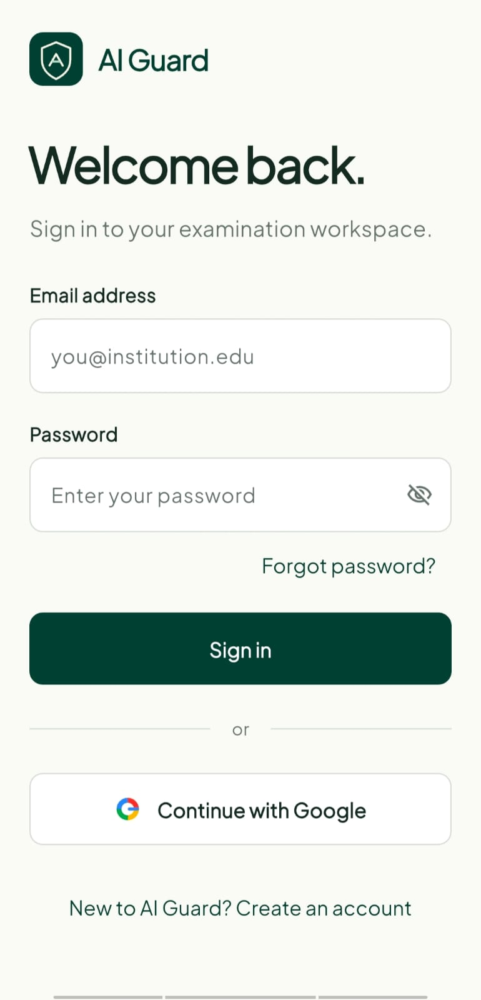
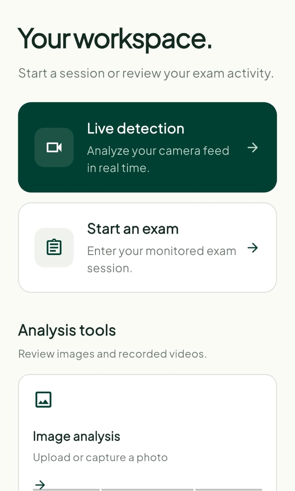
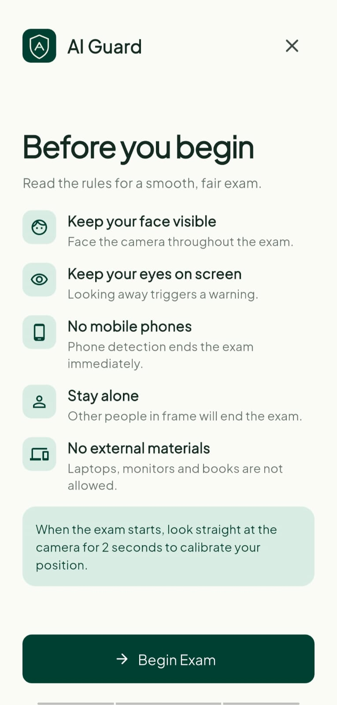
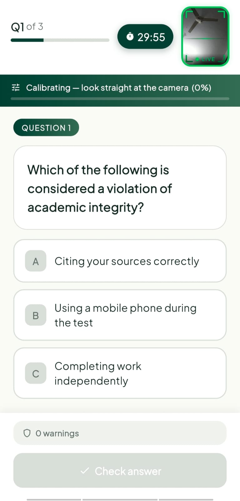
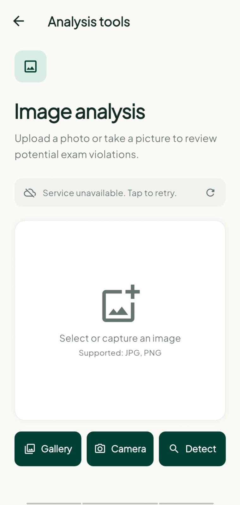
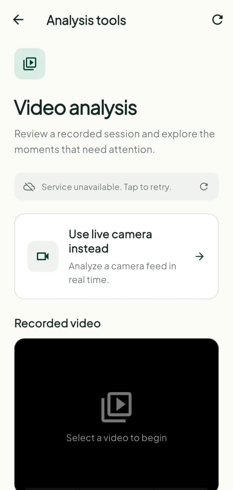
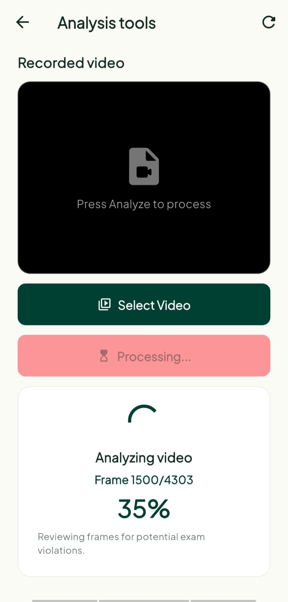
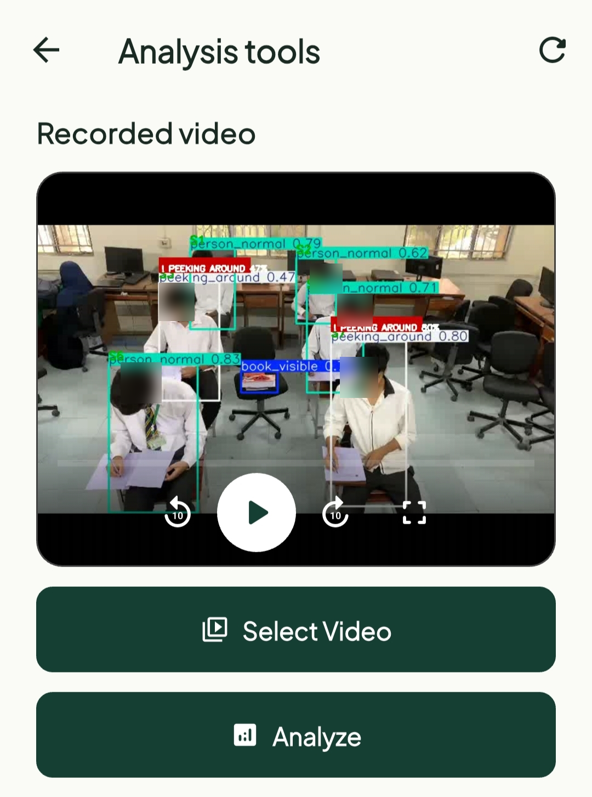
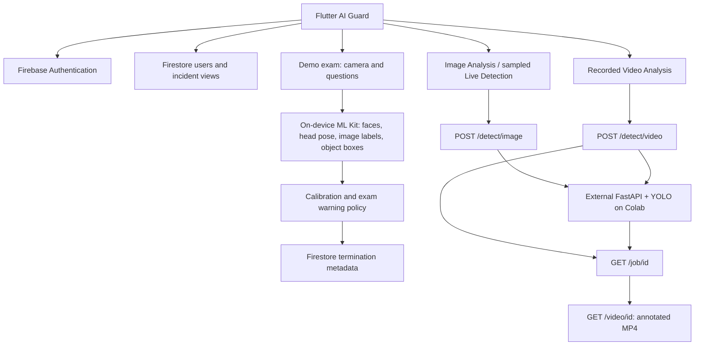

<p align="center"></p>

# AI Guard

**AI-Based Examination Cheating Detection System**

A final-year Flutter project for monitored demonstration exams and review of
images, camera samples and recorded video. Firebase provides authentication and
incident storage. The repository contains the FastAPI + YOLO service used by the
Colab development deployment; its model weights remain external.

The two detection paths are deliberately distinct: **exam monitoring uses local
Google ML Kit; image/video media analysis uses a remote API**. Backend source is
in `backend/main.py`. The model `best_model_merged.pt` stays in Google Drive and
is copied to `/content/best_model_merged.pt` in Colab; it is not included here.

## Overview

AI Guard helps surface observations for human review. Detections are probabilistic:
false positives and false negatives are possible. Output must **not be the sole
basis for academic disciplinary action**. Model performance depends on training
data, camera position, lighting and the examination environment.

## Key features

- Email/password login, registration, password reset and Google Sign-In.
- Pending/approved/rejected access workflow with student, teacher and web-admin
  workspaces; server-side Firestore authorization must be configured separately.
- Exam rules, front-camera preview, 15-sample head-pose calibration, three demo
  questions, 30-minute timer, classified warnings, termination and local completion summary.
- Gallery/camera image selection, remote multipart analysis and annotated results.
- Recorded-video preview, asynchronous upload/job polling, frame/percentage
  progress, error handling and processed-video playback.
- Remote YOLO violation detection, approximate seat tracking and per-seat risk
  summaries for recorded videos.
- Separate remote Live Detection mode that sends sampled JPEG frames.
- Teacher incident views and administrator approval/review screens.
- Cream background, dark-green accents, rounded cards and responsive layouts.

## Demo / app preview

Privacy-sanitized captures from the working application are included below. They
show the authentication, workspace, monitored-exam and remote media-analysis
flows. These screenshots demonstrate UI and integration behavior; they are not
an independently measured detector-accuracy or performance benchmark.

<table>
  <tr>
    <td align="center"><strong>Sign in</strong><br></td>
    <td align="center"><strong>Workspace</strong><br></td>
  </tr>
  <tr>
    <td align="center"><strong>Exam rules</strong><br></td>
    <td align="center"><strong>Exam monitoring</strong><br></td>
  </tr>
  <tr>
    <td align="center"><strong>Image analysis</strong><br></td>
    <td align="center"><strong>Video analysis</strong><br></td>
  </tr>
  <tr>
    <td align="center"><strong>Video processing</strong><br></td>
    <td align="center"><strong>Processed result</strong><br></td>
  </tr>
</table>

The public captures are sanitized for portfolio use. Model output shown in the
processed-video example is illustrative project evidence and still requires
human review.

## How it works



See [system architecture](docs/ARCHITECTURE.md) for lifecycle, data ownership and
platform limitations. The diagram shows the inspected backend source; Colab
runtime behavior and private-model inference still need deployment checks.

## AI detection classes

| ID | Remote model class | Meaning |
| --- | --- | --- |
| 0 | `book_visible` | Visible book/material |
| 1 | `passing_note` | Possible note passing |
| 2 | `peeking_around` | Possible looking around |
| 3 | `person_normal` | Normal-person observation |
| 4 | `showing_paper` | In `SKIP_CLASSES`; excluded from video detections and violations. It may remain a neutral raw image detection. |
| 5 | `using_mobile` | Possible mobile use |

Class IDs and thresholds match the inspected backend source. External weights
and deployed Colab version are **NOT VERIFIED**. Read [model notes](docs/MODEL.md).

## Detection pipeline

Raw model observations and accepted violations are separate. Flutter displays
raw live detection entries neutrally and shows backend-provided accepted
violations separately. The backend draws raw image/video boxes in gray; red
banners and incidents require the class threshold, and video events also need a
three-observation streak and cooldown. Source logic has tests; output from the
private model and live runtime remains unverified.

## Recorded video analysis

Select video → local preview → Analyze → multipart upload → job ID → bounded
status polling → progress → completed result → annotated-video playback.

The client supports MP4/MOV/AVI/MKV uploads up to 250 MiB. Playback depends on the
device and output codec. Uploads have a three-minute deadline; processing polling
has a 30-minute deadline and retries at most five consecutive transient failures.
Leaving the screen closes requests and stops polling; the current API contract
has no server-side cancel endpoint. The backend removes uploaded video inputs
when a job finishes or fails; processed outputs have no automatic retention
limit. Abrupt runtime interruption may leave temporary files.

Seat IDs identify approximate seat slots, not biometric identities. The reported
`risk_pct` is a heuristic score (`min(accepted_event_count * 10, 100)`), not a
probability of cheating. Seat matching and risk summaries require human review.

## Live exam monitoring

The exam uses ML Kit face detection, pose estimates, image labeling and coarse
object boxes. Phone evidence uses a two-sample confirmation; other local signals
have their own counters. Warnings distinguish phone/device, missing/multiple
faces, head pose and looking away. The current strict demo policy stops the exam
at a confirmed terminating condition and attempts to save incident metadata.

The installed Android mesh provides 468 landmarks, while the legacy iris branch
requires 478; **eye-only iris tracking is unavailable with that output**. iOS
face mesh is unsupported by the installed plugin. Head-pose-based “gaze” is an
approximation. Local attention scores are heuristics, not probabilities.

The three-question exam is a demonstration, not a question-bank authoring,
secure assessment or grade-management system. Completion scores are local only.

## Tech stack

| Layer | Implementation |
| --- | --- |
| Flutter application | Dart, Material, `StatefulWidget`/`setState`, streams and `ValueNotifier` |
| Identity/data | Firebase Auth, Google Sign-In, Cloud Firestore |
| Local exam AI | Google ML Kit plugins, with retained iOS compatibility patches |
| Remote media client | `http`, multipart requests, `image_picker`, `video_player` |
| Remote backend | Python, FastAPI, Uvicorn, Ultralytics YOLO, OpenCV, NumPy, SciPy |
| Demo hosting | Google Colab + ngrok, temporary development infrastructure |

## Project structure

```text
lib/
  config/             Central API configuration
  screens/auth/       Login and registration
  screens/dashboard/  Role workspaces and monitored demo exam
  screens/            Image, video and remote live analysis
  services/           Auth, HTTP, ML Kit, camera and media helpers
  models/             Response and approval models
  widgets/            Shared responsive components and rules
  branding/, theme/   Existing visual identity
third_party/          ML Kit packages with documented iOS compatibility changes
backend/              FastAPI source, runtime requirements and mock tests
colab/                Credential-free development instructions
assets/               Branding/fonts; local model artifacts excluded from publication
test/                 Flutter unit/widget regression tests
tool/                 Local publication/security/asset helpers
docs/                 Architecture, API, model, security, asset and audit notes
.github/workflows/    Flutter, backend and publication-tool checks
```

## Getting started

### Flutter setup

The audit uses Flutter **3.29.2 / Dart 3.7.2**, matching the existing environment
and lockfile. Android uses Java 17 targets, AGP 8.7.0, compile/target SDK 35,
min SDK 24, and NDK 27.0.12077973. Use a compatible JDK (17 or 21), Android SDK and
a physical device/emulator. A local absolute Java installation path is no longer
stored in Gradle configuration.

```sh
flutter pub get
```

Do not upgrade all dependencies as part of initial setup. Keep `pubspec.lock`.

### Firebase setup

1. Create/select **your own** Firebase project. Enable email/password and Google
   authentication, register the existing Android ID `com.example.aicheat`, and
   configure the appropriate SHA fingerprints for Google Sign-In.
2. Install/configure FlutterFire tooling and run `flutterfire configure` for the
   platforms you intend to run. Generate `lib/firebase_options.dart`, Android's
   `google-services.json`, and Apple `GoogleService-Info.plist` locally. These
   real project files are intentionally ignored, not bundled with the public snapshot.
3. Configure Firestore authorization before using real data: users may request
   student/teacher roles with `status: pending`, but must not approve themselves
   or grant themselves admin access. Provision the first admin through a trusted
   administrative channel. See [security requirements](docs/SECURITY.md).
4. Apple Google Sign-In requires client ID/callback setup. Consult the
   [iPhone setup notes](docs/IOS_IPHONE_SETUP.md), treating historical device
   checks as historical rather than proof for your installation.

Deployed Firebase/Firestore rules have **not been independently verified**.
This snapshot does not establish production-grade Firebase security.

For **offline analysis/tests only**, a compile-only placeholder is provided:

```sh
cp lib/firebase_options.example.dart lib/firebase_options.dart
```

Do not overwrite an existing real configuration with that command. The
placeholder cannot authenticate users and is not intended for a deployed app.

### Backend setup / model

The API implementation is [`backend/main.py`](backend/main.py). Install
[`backend/requirements.txt`](backend/requirements.txt) in Python 3.10+, put the
private model at `/content/best_model_merged.pt`, then run
`uvicorn main:app --host 0.0.0.0 --port 8000` from `backend/`. Follow the
[Colab instructions](colab/README.md) for the demo tunnel. Model size,
evaluation, provenance and distribution rights remain unverified. No model
weights are included in this portfolio snapshot, and no download link is provided.

### Google Colab and ngrok development setup

Use the [Colab instructions](colab/README.md). Read `NGROK_AUTHTOKEN` from Colab
Secrets, never from a committed string. Colab/ngrok is for development/demo use,
not permanent production hosting. Runtime restarts may invalidate jobs/results.

### Running the app

```sh
flutter run --dart-define=API_BASE_URL=https://your-demo-host.example.com
```

Replace the example with the current HTTPS tunnel or your deployed API. The
single source of truth is `lib/config/api_config.dart`; no API token is needed
or accepted as source configuration. Restart/rebuild after changing dart-defines.
Without an endpoint, Firebase and local exam features still work with valid
Firebase setup, while remote analysis reports the service unavailable.

Android debug builds permit local HTTP (for example an emulator's host bridge).
Release builds require HTTPS. The primary camera/exam target is Android; iOS
hardware, remote playback and desktop/web camera behavior need separate testing.

## API endpoints

| Method | Path | Client use |
| --- | --- | --- |
| GET | `/health` | Availability check |
| POST | `/detect/image` | Multipart `file`; annotated image and detections |
| POST | `/detect/video` | Multipart `file`; returns `job_id` |
| GET | `/job/{job_id}` | Status, message, progress and completion summary |
| GET | `/video/{job_id}` | Processed video media |

See [API details](docs/API.md), including the inspected server responses and
remaining runtime limitations.

## Testing

```sh
flutter pub get
dart format --set-exit-if-changed .
flutter analyze
flutter test --reporter expanded
python3 -m compileall -q backend
python3 -m pytest backend/tests -q
```

Formatting applies changes; inspect them if the command exits nonzero. CI checks
formatting without writing files, analyzes Flutter, and runs unit/widget tests
using the compile-only Firebase example. Backend tests mock YOLO and need no
weights. No real account or deployed API is needed.

Backend syntax/pytest are run independently from Flutter checks. Full
device-to-Colab/Firebase integration remains **NOT VERIFIED**. See the
[implementation audit](docs/AUDIT_REPORT.md) and
[public repository audit](docs/PUBLIC_REPOSITORY_AUDIT.md) for exact checks. A
passing mocked test is not a detector-accuracy test.

## Security & privacy

- Keep credentials, signing files, generated Firebase configuration, logs,
  private videos, environments and model weights out of Git.
- Firebase client configuration identifies a project; it is not a substitute for
  authorization. This repository chooses to keep real project config local.
- The remote API client sends no Firebase bearer token, and the demo backend has
  no authentication or rate limit. Wildcard CORS is retained for Colab/ngrok
  only. Do not expose private exam media through this service.
- Use informed consent, a retention policy and human review. Screenshots should
  use generic demo identities and consented media.
- Third-party licenses and attribution notices remain intact.

Read [security and publication guidance](docs/SECURITY.md).

## Known limitations

The backend source is included and its thresholds, skip class, streak/cooldown,
response schemas, seat matching and risk rules have mock/unit coverage. Model
weights and accuracy metrics remain external. Fixed seat anchors can lose a
person who moves beyond the 150-pixel matching gate; anchors do not expire, so
a later occupant near that seat can inherit its slot and accumulated risk. IDs
are seat slots, not identities. Firestore deployed rules, real OAuth flows,
device camera accuracy,
interruptions and native codec playback require integration testing. Camera
streams suspend on background/route changes, but hardware behavior varies. The
exam uses strict heuristics and a local demo quiz, not a validated disciplinary
assessment system.

## Future improvements

Add authenticated media access, retention controls, bounded/durable job recovery,
a documented evaluation set,
per-class error analysis, device profiling and durable examination/result data.
Avoid claiming these as implemented features.

## Academic context

AI Guard is a final-year academic/portfolio project demonstrating mobile UI,
authentication, camera processing and asynchronous AI-service integration. Its
purpose is to assist review, not determine intent or replace institutional due
process. Dataset/model rights and any research claims must be established before
public distribution or operational use.

## License

This repository is released under the **GNU Affero General Public License,
version 3 (AGPL-3.0)**. See [LICENSE](LICENSE) for the unmodified license text.
Third-party components retain their own licenses and notices.

Commercial or proprietary deployment may require different licensing from
third-party dependencies such as [Ultralytics](https://www.ultralytics.com/license).
Review their current terms for your intended use. This statement is not a legal
guarantee. The trained model weights are not included in this snapshot.
