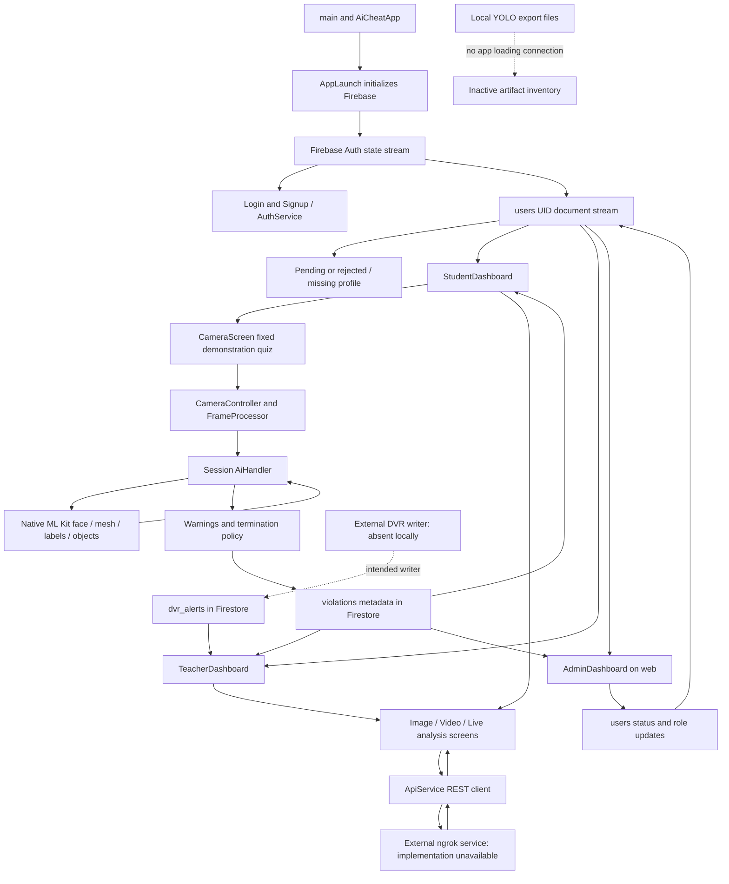
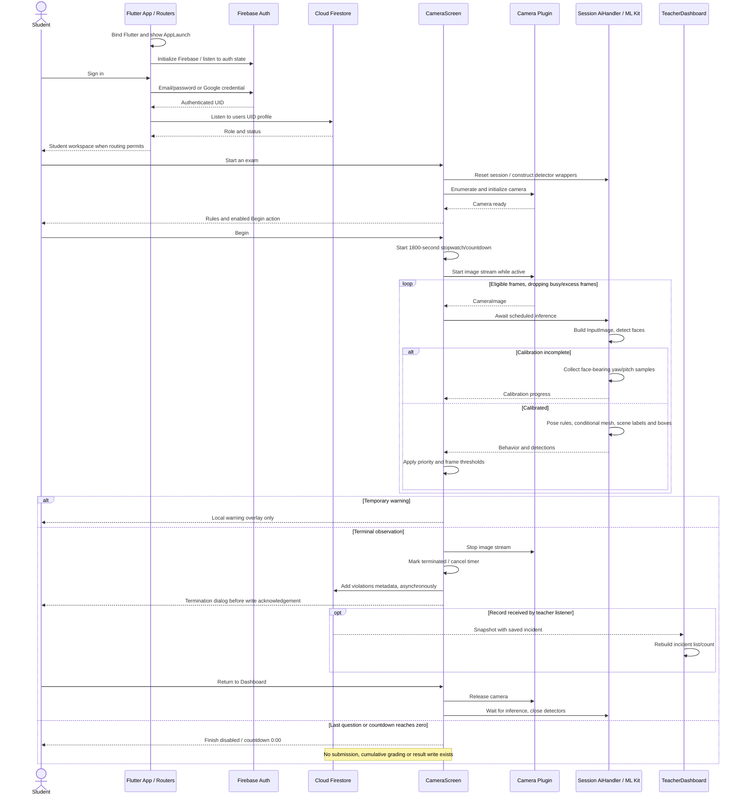

> Historical review/setup notes. Source line numbers and earlier findings may be stale. See [the current audit](AUDIT_REPORT.md) for this preparation pass.

# AI-Based Examination Cheating Detection System — Complete Project Analysis

**Inspected workspace:** `<project-root>`
**Inspection date:** 9 October 2026
**Application names in source:** `aicheat`, “AI Guard”, and “AI Guard Pro”
**Scope:** Investigation and documentation only. Only this requested report was created and extended, including after the interrupted session. No application code, Firebase configuration, model, or other existing documentation was edited. No cloud data was read or changed. No deployment, installation, training, or real-device experiment was performed.

## 1. Executive Summary

The repository implements a Flutter examination-proctoring prototype with Firebase account approval, student/teacher/admin workspaces, a camera-monitored demonstration quiz, and separate remote image/video/live-analysis tools. Its most important architectural distinction is that **the monitored exam uses Google ML Kit locally, whereas the other analysis tools send media to an external HTTP service**. Local YOLO files are present but are not loaded by the Flutter implementation.

The examination screen has substantive camera, calibration, head-pose, face-count, scene-label, warning, termination, and Firestore incident-writing logic. However, it is **not a complete examination-management system**: questions are hardcoded, there is no exam creation/listing/enrolment data model, no answer persistence or cumulative grading, the last question's “Finish exam” button has no handler, and reaching zero on the countdown does not submit or end the exam. Teacher monitoring means observing incident records through Firestore listeners; it does not mean receiving a continuous student camera feed.

The eye-only iris branch requires 478 landmarks, including indices 468 and 473. The installed face-mesh plugin's documented contract provides 468 points, numbered 0–467. This is a verified integration mismatch, so successful eye-only gaze detection must not be claimed from this repository. Head-angle-based gaze remains a separately implemented branch.

**Current validation:** `flutter test --no-pub --reporter expanded` passed **79 tests**. `flutter analyze --no-pub` completed with **11 findings**, all in the unused duplicate `lib/services/ai_handler 2.dart`: three warnings and eight informational lints; exit code 1. These results establish the tested software behavior, not AI accuracy, native camera compatibility, deployed authorization, or remote-server availability.

### Evidence conventions

| Label | Meaning in this report |
|---|---|
| **Verified** | Directly observed in local source, configuration, binary metadata, installed dependency source, or the checks run during this investigation. “Implemented” does not automatically mean verified on hardware. |
| **Inferred** | A conclusion drawn from traced code or metadata, without direct runtime proof. |
| **Requires Verification** | Needs native-device testing, external backend/Colab source, live Firebase configuration, dataset records, or official FYP documentation. |

References such as `lib/services/ai_handler.dart:375–405` identify source locations in the inspected snapshot. Line references can change after future edits. Findings about missing features are based on the complete primary source inventory and searches across it, rather than a single absent filename. Training/deployment claims in UI text or documentation are treated as intended design unless executable code or model metadata corroborates them.

**Inspection accounting:** 46 primary source files were inspected: 32 Dart files under `lib/`, 12 Dart tests, one historical Dart model under `assets/models/`, and one Python branding utility. Native bootstrap sources, platform build/configuration files, Firebase configurations, existing documentation, labels, and model artifacts were additionally inspected and are listed separately in the appendix. Generated dependency trees and compiled caches were excluded except for relevant local dependency contracts, package versions, and model-schema reading support.

## 2. Project Objectives and Problem Statement

### Actual purpose and real-world problem

**Verified:** The app attempts to identify visible behavior associated with examination misconduct and prevent a monitored quiz from continuing when configured violation thresholds are met. It also provides tools for reviewing uploaded images and videos. Evidence: `pubspec.yaml:1–5`; `lib/widgets/exam_instructions.dart:18–44`; `lib/screens/dashboard/camera_screen.dart:284–463,518–528`; `lib/screens/detection_screen.dart:111–149`; `lib/screens/video_detection_screen.dart:91–189`.

**Inferred:** The underlying problem is that a teacher supervising a remote or camera-observed exam cannot continuously inspect every student's attention, surroundings, and use of external materials. Automated observations and incident lists are intended to assist that supervision. A visible phone or head turn is an observation, not conclusive proof of cheating intent; the code applies its policy without investigating the student's explanation.

### Users and implemented access

Students can enter the demonstration exam and use the analysis tools. Teachers can review incident lists, group incidents by student, read DVR alerts, and use the analysis tools. Administrators manage account approvals and roles and read incident records through a browser. The app checks Firestore profile status before selecting the workspace. This is client-side navigation; database-level enforcement is not verifiable because security rules are absent locally.

### Objective-to-implementation mapping

| Objective/claim | Observed status | Evidence |
|---|---|---|
| Authenticate users and approve institutional access | Implemented client workflow; live service setup unverified | `lib/services/auth_service.dart:11–88,130–177`; `lib/main.dart:113–163` |
| Monitor face visibility, additional faces, head orientation and prohibited materials | Implemented local pipeline and exam policy; device effectiveness unmeasured | `lib/services/ai_handler.dart:451–922`; `lib/screens/dashboard/camera_screen.dart:284–463` |
| Detect eye-only iris movement | Conditional implementation with incompatible expected landmark count | `lib/services/ai_handler.dart:937–951`; installed plugin contract described in §10 |
| Record an examination incident for teachers | Implemented metadata write and listeners | `camera_screen.dart:770–792`; `teacher_dashboard.dart:309–385` under `lib/screens/dashboard/` |
| Create exams as a teacher | Mentioned in role-description text, absent in executable teacher workflow | `lib/screens/auth/signup_screen.dart:32–36`; `lib/main.dart:250–255`; teacher source inventory |
| Custom YOLOv8s, ByteTrack, FastAPI on Colab | Static admin information; remote implementation absent | `lib/screens/dashboard/admin_dashboard.dart:668–683` |
| Complete exams and publish marks | Missing | `lib/screens/dashboard/camera_screen.dart:1673–1675,1762–1775`; no result writer |
| Save image/video evidence of exam incidents | Missing from local exam flow | `lib/screens/dashboard/camera_screen.dart:775–788` writes metadata only |

The complete implemented workflow and the gaps in completion are reconstructed in §13. No official FYP objectives, team names, research results, or Colab notebook were found in this workspace.

## 3. Project Structure and Directory Overview

```text
aicheat/
├── lib/
│   ├── main.dart, firebase_options.dart
│   ├── branding/                  Startup cover and painted logo
│   ├── navigation/                Route observer and page transitions
│   ├── screens/auth/              Login, signup, shared form layout
│   ├── screens/dashboard/         Role workspaces, pending access, exam camera
│   ├── screens/*detection*.dart   Remote image, video and live tools
│   ├── services/                  Auth, HTTP, local ML, frame/camera helpers
│   ├── models/                    Remote JSON response objects
│   ├── theme/                     Material theme and local font
│   └── widgets/                   Instructions, responsive and workspace UI
├── test/                          12 Flutter test source files
├── android/                       Android native runner, Gradle, permissions
├── ios/, macos/                   Apple runners and Firebase plist files
├── web/                           Flutter bootstrap HTML, manifest and icons
├── linux/, windows/               Desktop runner scaffolding
├── assets/models/                 Two unused TFLite files, labels, old DTO
├── assets/fonts/, assets/branding/ Local font, artwork
├── yolov8s_saved_model/            SavedModel and float32/float16 TFLite exports
├── yolov8s.pt, yolov8s.onnx        Additional inactive model artifacts
├── calibration_*.npy              Numeric calibration sample artifact
├── yolo_env/                      Local Python environment; not app/backend source
├── tool/generate_brand_assets.py  Icon/launch-artwork generator
├── pubspec.yaml, pubspec.lock      Flutter dependencies and resolved versions
├── firebase.json                 FlutterFire app registrations
├── README.md, CLAUDE.md           Template readme and partly stale project notes
└── docs/ui-performance-review.md  Prior review/test/build claims
```

**Verified absent:** `functions/`, `integration_test/`, an application backend directory, Colab `.ipynb` files in the inspected project sources, Firestore/Storage rules and index definitions, and a local `dvr_show.py`. The only first-party Python utility found is the branding generator; it does not perform inference. A Python environment containing ML packages is not itself a server or training implementation.

`README.md:1–16` is generic Flutter starter documentation. `CLAUDE.md` describes an older startup route, older thresholds, and a Google-sign-in stub; current code differs. `docs/ui-performance-review.md` contains useful prior claims but its release-build and device-performance statements must be distinguished from checks performed here.

Ignored areas include `.git/`, `.dart_tool/` caches, `build/` and nested Android build outputs, `.gradle/`, `.cxx/`, IDE state, and Python `site-packages` implementations unrelated to the questions being verified. Firebase files ignored by `.gitignore` do physically exist and were examined with credential values suppressed.

## 4. Complete Technology Stack

Versions below are **Verified from `pubspec.lock`**, rather than assumed from the looser caret constraints in `pubspec.yaml:11–44`.

| Technology/package | Resolved version | Purpose, use location and interaction |
|---|---|---|
| Flutter / Dart | Local Flutter SDK 3.29.2; local package configuration generated by Dart 3.7.2 | UI, async control, platform-channel calls and tests. Project Dart constraint `>=3.7.2 <4.0.0`; lock requires Flutter `>=3.29.0`. SDK metadata is local environment evidence, not a deployment guarantee. |
| `firebase_core` | 3.15.2 | Initializes platform Firebase app; `lib/main.dart:23–25` and `firebase_options.dart` |
| `firebase_auth` | 5.7.0 | Email/password accounts, provider credentials, reset email, session state; `auth_service.dart` |
| `cloud_firestore` | 5.6.12 | Profiles and incident records; streams rebuild workspaces |
| `google_sign_in` | 6.3.0 | Obtains Google credential tokens for Firebase; `auth_service.dart:149–158` |
| `camera` | 0.11.2+1 | Native camera enumeration, preview and image streaming; exam and live screens |
| `google_mlkit_face_detection` | 0.11.0 | Face count, Euler angles, eye-open probabilities; local exam pipeline |
| `google_mlkit_face_mesh_detection` | 0.1.1 | Face mesh supplied over native channels; attempted iris logic has a contract mismatch |
| `google_mlkit_image_labeling` | 0.12.0 | Whole-image labels scored heuristically as Phone/Laptop/Monitor/Book |
| `google_mlkit_object_detection` | 0.12.1 | Generic object boxes after a stable prohibited-material label |
| `google_mlkit_commons` | 0.7.1, transitive | `InputImage`, rotation, byte-format metadata shared by ML plugins |
| `http` / `http_parser` | 1.6.0 / 4.1.2 | Multipart media uploads, GET status/health and MIME types; `api_service.dart` |
| `image_picker` | 1.2.1 | Gallery selection, still-photo capture; image/video tools |
| `image` | 4.8.0 | Dart YUV-to-RGB image creation, rotation and JPEG encoding in live tool; also test-image creation |
| `video_player` | 2.10.1 | Streams processed video from HTTP service, seeks to incident times |
| `flutter_test` | Flutter SDK dependency | Widget/unit tests, fake controllers and mocked native channels |
| `flutter_lints` | 5.0.0 | Static analysis configuration in `analysis_options.yaml` |
| `google_fonts` | 6.3.2 | Declared dependency; no active GoogleFonts import/call found. Active typography uses a bundled font. |
| `path_provider` | 2.1.5 | Declared dependency; no first-party import/call found |
| `cupertino_icons` | 1.0.8 | Declared icon-font dependency; explicit CupertinoIcons usage was not found |

Other confirmed languages and tools: Kotlin and Gradle Kotlin DSL for Android configuration; Swift for Apple bootstrap/template tests; C++ for desktop runners; HTML/JavaScript/JSON for Flutter web bootstrap and manifest; Python/Pillow for branding artwork. Android Studio is supplied as user context, not established through a live IDE inspection. FlutterFire-generated options and Firebase app files are present. Git reports the project files as untracked in this checkout, so there is no trustworthy committed-change baseline or author attribution available here.

### ML/export environment versus application technology

The existing `yolo_env` distribution metadata records Ultralytics 8.1.0, TensorFlow 2.15.0, PyTorch 2.2.2, ONNX 1.16.0, ONNX Runtime 1.19.2 and OpenCV Python 4.11.0.86. These establish installed local tools only. They do not establish a running Python inference server, training configuration, or integration of OpenCV/PyTorch/ONNX Runtime into Flutter. TensorFlow schema code and ONNX were used here only to inspect artifact metadata without running inference or training.

There is no `tflite_flutter` dependency or interpreter loading call in the app. An Android comment mentioning that package (`android/app/build.gradle.kts:26`) is historical text. “MediaPipe” appears in iris comments, but the executable integration imports Google ML Kit, not a direct MediaPipe SDK.

## 5. System Architecture

### Observed architecture

**Verified:** This is a Flutter widget-and-service architecture with screen-local mutable state and direct Firebase access. UI classes call services for authentication, external HTTP and local ML processing. Many Firestore queries and writes live directly in widgets. There is no repository abstraction, dependency-injection framework, or consistently separated application/domain/data layers supporting a Clean Architecture, MVC or MVVM designation.

| Layer/component | Observed responsibility |
|---|---|
| Startup/presentation | `AiCheatApp`, `AppLaunch`, role workspaces, analysis screens and shared widgets |
| Authentication | `AuthService`, Firebase Auth state stream and per-user Firestore profile stream |
| Local monitoring | `CameraScreen` → `FrameProcessor` → session `AiHandler` → native ML Kit |
| Exam enforcement | `CameraScreen._onAiResult` applies thresholds, warnings and termination |
| Persistence | Direct Firestore SDK reads/writes of `users`, `violations`, and read-only `dvr_alerts` |
| Remote inference client | `ApiService` multipart REST calls; remote server source is absent |
| Platform integration | Flutter camera/ML/image/video plugins, native runner scaffolding |



The remote service is an architectural dependency established by request code; its implementation as FastAPI/Colab/YOLO/ByteTrack is **Requires Verification**. The dotted DVR writer is an intended integration inferred from UI instructions, not a located implementation. There is no remote-media-to-Firestore connection in the inspected Flutter code.

### Where processing and data live

The monitored quiz's ML runs through native on-device APIs; Dart performs scoring, counter updates and enforcement. Quiz options, counters, calibration samples and violation logs are held in memory. Firebase stores account profiles and terminal incident metadata. Remote tools upload media and display returned results; annotated image bytes stay in memory, and processed video is read from the service URL. Remote retention, job storage, compute hardware and model selection are unknown. No custom local SQL/SQLite/Hive/SharedPreferences database is used in first-party source.

## 6. Modules and Major Code Responsibilities

| Module | Entry and execution | Data/output | Integration and limitations |
|---|---|---|---|
| App startup | `main` → `AiCheatApp` → `AppLaunch` | Firebase ready, then authenticated destination | Async failure/retry and first-painted-frame launch removal; ML engines are not initialized in `main` |
| Account management | Login/signup button callbacks → `AuthService` | Auth session and `users/{uid}` | Firestore approval status controls workspace, not Firebase account creation; rules unavailable |
| Student workspace | `_RoleRouter` default role route | Navigation and latest personal incidents | No available-exam catalogue; opens a fixed `CameraScreen` |
| Exam monitoring | `CameraScreen.initState` initializes camera and session AI | Behavior and detections, warnings, terminal incident | No complete submission/grading workflow |
| Local AI | `runInferenceMobile` → `_runPipeline` | `BehaviorState`, `IrisGazeState`, normalized boxes | ML Kit plus heuristics; landmark mismatch, image-format risk and no accuracy evidence |
| Teacher workspace | Role route, selected tab and Firestore streams | Latest incidents, grouped incidents, DVR records | No camera streaming, exam creation or marks management |
| Admin workspace | Web-only role route | Account status/role changes, statistics and incidents | Full collections observed through listeners; server permissions unknown |
| Image analysis | Health check, gallery/capture, Analyze | Remote JSON and Base64 annotation | Network/backend dependent; results are not written to Firestore |
| Video analysis | Upload → poll job → load processed video | Risk summaries and seekable incident timeline | Remote risk/tracking formulas unknown; no backend cancellation implemented |
| Standalone live analysis | Start/stop, camera frames → JPEG → HTTP | Annotated frame, local event history | One request at a time; no Firestore incident logging; decoded detection-list getter is a stub |
| Shared UI/platform | Widgets, theme, native runners | Responsive presentation and plugin hosting | Platform folders alone do not prove feature parity |

Precise classes/methods and callers are indexed in §14. The camera, ML and persistence algorithms are detailed in §§10–13 rather than duplicated here.

## 7. User Roles and Authentication

### Registration and login

1. **Email registration:** `SignupScreen._handleSignUp` (`lib/screens/auth/signup_screen.dart:68–171`) requires name/email/password, equal password confirmation, and at least six password characters. It calls `AuthService.signUp`.
2. `AuthService.signUp` (`lib/services/auth_service.dart:11–39`) converts an attempted `admin` role to `student`, creates the Firebase Auth account, writes a profile with `status: pending`, then signs out. Its profile write and Auth account creation are separate operations; there is no rollback if the write fails.
3. **Email login:** `_handleLogin` (`lib/screens/auth/login_screen.dart:46–82`) calls `AuthService.login`. The service signs into Firebase, then explicitly requests the profile from `Source.server` (`auth_service.dart:45–83`). It returns a status/error marker for UI messaging. It does not sign out a pending/rejected account.
4. `_AuthRouter` (`lib/main.dart:46–61`) reacts to `authStateChanges`. `_RoleRouter` listens to the user's profile document (`main.dart:113–163`) and displays the appropriate destination.
5. **Google authentication:** login and signup both call `AuthService.signInWithGoogle` (`auth_service.dart:149–158`). It requests a Google account, obtains provider tokens, and passes a `GoogleAuthProvider` credential into Firebase Auth. This is implemented code, not the stub described in `CLAUDE.md`.
6. For a newly authenticated Google user without a profile, `_NoProfileScreen` allows student/teacher selection and `_completeSetup` writes a pending Google profile and signs out (`lib/main.dart:198–239`). The similar `AuthService.createGoogleUserProfile` method exists but no active caller was found.

Successful Google provider configuration is **Requires Verification**: inspected Android Firebase configuration contains no OAuth-client entries; Apple Firebase plists have no `CLIENT_ID`; no explicit web client-ID setup was found. These are configuration gaps to investigate, not a measured login failure.

### Role/status rules implemented in navigation

| Profile state | Destination/access in current source |
|---|---|
| No authenticated user | Login screen |
| Authenticated, Firestore stream error | Account error UI with sign-out |
| Authenticated, missing profile | Google setup if Google provider; otherwise contact-admin fallback |
| `status == pending` | Awaiting-approval screen |
| `status == rejected` | Access-denied screen |
| Other status, `role == admin`, web | Admin workspace |
| Other status, `role == admin`, native platform | “Web Access Only” screen |
| Other status, `role == teacher` | Teacher workspace |
| Other status, any other role | Student workspace |

Missing role defaults to `student`; missing status defaults to `pending`. **Verified issue:** the router checks only pending and rejected, not `status == approved`; an unexpected nonempty status bypasses those two blocks. Unknown roles become students. Native student/teacher access is not enforced as mobile-only: unlike admins, these roles have no `kIsWeb` restriction (`main.dart:145–162`).

Role and status are application data in Firestore, not Firebase custom claims. Admin approval/rejection updates a Firestore field (`auth_service.dart:130–139`); it does not disable a Firebase Auth account. Public signup offers only student and teacher. Provisioning the first administrator is not implemented/documented locally.

### Recovery, logout and security boundary

Password recovery uses a login dialog and `sendPasswordResetEmail` (`login_screen.dart:84–167`; `auth_service.dart:142–144`). Student, teacher, admin and pending screens call Firebase sign-out. No email verification, MFA, identity matching, account deletion, or biometric identification workflow was found. The unused dashboard's “VERIFY ID” button does nothing.

No passwords are written into the profile document. Firebase/Auth secret values and signing credentials are intentionally omitted from this report. Client-side role routing cannot prove database authorization; deployed Firestore rules and external API permissions must be reviewed separately.

## 8. Student and Examination Workflow

### Workspace and instructions

`StudentDashboard.build` (`lib/screens/dashboard/student_dashboard.dart:16–49`) uses Firebase Auth display name/email/photo, signs out directly, and opens four routes: live analysis, exam, image analysis and video analysis. The saved Firestore profile name is not fetched for the workspace heading, so an email signup's entered name is not automatically the Auth display name.

Recent activity is a listener on `violations.where(studentId == uid)` (`student_dashboard.dart:315–461`). It fetches all matching records, sorts by timestamp on the client and displays up to ten. It has no separate stream-error state.

`CameraScreen.initState` starts camera/AI preparation while rules are shown. `ExamInstructions` presents face visibility, on-screen attention, no phone, staying alone and no external materials (`lib/widgets/exam_instructions.dart:18–44`). It scales its static rules to fit short screens and keeps Begin separate. Begin is enabled when the camera is ready and no camera error exists (`camera_screen.dart:882–905` under `lib/screens/dashboard/`). A camera permission/initialization failure provides a retry.

### Quiz, answers and timer

**Verified:** The quiz has three academic-integrity multiple-choice questions, each with three options and correct zero-based answer index 1 (`lib/screens/dashboard/camera_screen.dart:97–127`). There is no selected exam ID, question download, exam schedule, enrolment check or question editor.

Selecting an option changes `_selectedOption`. `_checkAnswer` only sets `_answered = true`; `_buildOption` highlights the correct answer and any incorrect selection. `_nextQuestion` increments the index and clears the selection/answered state (`camera_screen.dart:1492–1607,1762–1775`). Earlier answers are discarded; there is no answer array, cumulative score, student submission document or marking service.

Begin starts a 30-minute local `Stopwatch`; a periodic timer recomputes `1800 - elapsedSeconds`, clamped to zero, and updates a `ValueNotifier` (`camera_screen.dart:45–55,794–802,896–903`). Only the header's `ValueListenableBuilder` responds to countdown ticks. This avoids relying on a count of timer callbacks, but time is neither supplied nor validated by a server.

**Confirmed completion gaps:** At zero the periodic callback stops updating the value, but performs no submission or termination. On the final answered question `onPressed: isLast ? null : _nextQuestion` disables the button labelled “Finish exam” (`camera_screen.dart:1673–1690`). There is no normal completion dialog, final score or result viewer. The timer continues to run in the background according to elapsed time while camera inference is suspended. Back navigation can leave the screen without a submission/incident handler; no `PopScope`/exit-logging policy was found in this screen.

### Monitoring outcome

After Begin, the stream runs while the route/app is active. The first 15 face-bearing inference samples calibrate baseline yaw/pitch; the student can already interact with quiz questions. After calibration, the AI callback updates observations and enforcement. Terminal violations stop the stream/timer, show an incident dialog, and attempt a metadata write. Return to Dashboard pops the dialog and exam route (`camera_screen.dart:518–528,711–721,770–792`). Starting another route creates a fresh local session; no persistent exam lock prevents restarting.

## 9. Teacher/Admin Workflow

### Teacher workspace

`TeacherDashboard` (`lib/screens/dashboard/teacher_dashboard.dart`) enters through `_RoleRouter` and provides:

| Feature | Execution/data | Outcome and limitation |
|---|---|---|
| Global violation count | `_liveViolationCount`, lines 266–307; entire `violations` stream | Count of saved records, not current exam sessions or transient warnings |
| All Violations | `_allViolations`, lines 310–340; timestamp descending, limit 50 | Lazy incident cards showing reason/email/time/attention |
| By Student | `_violationsByStudent`, lines 343–385; all incidents ordered by timestamp | Groups by email, then UID fallback, into expansion tiles; not scoped to a teacher/class |
| DVR Alerts | `_dvrAlerts`, lines 389–562; `dvr_alerts`, latest 50 | Displays external violation/confidence/source/time records; no local writer |
| Analysis tools | Button routes, lines 65–79,123–175 | Image/video/live tools run independently of the student exam |
| Logout | Line 87 | Firebase sign-out |

Cards are built by `_violationCard` (lines 636–727) and grouped cards by `_studentGroup` (564–634). Empty DVR UI refers to running `dvr_show.py` on a Mac (424–440); that source is unavailable in the workspace. No evidence-image URL, evidence viewer, incident adjudication, notification push, exam editing, marks approval, CSV/PDF export or result management is implemented here. Most teacher listeners read `snap.data?.docs ?? []` without checking `snap.hasError`, so permission/network errors can look like empty data.

### Admin workspace

`AdminDashboard` (`lib/screens/dashboard/admin_dashboard.dart:28–71`) holds user and incident streams and passes presentation into `AdminWorkspace`. The latter renders wide sidebar or narrow navigation layouts (`lib/widgets/admin_workspace.dart:24–44,110–349`).

The Approvals tab filters cached snapshots to pending users, sorts registration dates and supplies Approve/Decline actions (admin dashboard lines 169–346). Users lists everyone and offers student/teacher/admin roles plus approval/rejection (349–537). Actions call `AuthService.approveUser/rejectUser`, or update `users/{docId}.role` directly (828–869). Violations reads and client-sorts the full incident collection (561–606). Statistics are derived from those snapshots, rather than measured session telemetry (73–150). These sections implement explicit stream-error UI.

The System tab is static information (664–723). Its statements “YOLOv8s — custom trained”, “ByteTrack algorithm”, and “FastAPI on Google Colab” are not server inspections or health measurements. Account access depends on both Firebase identity and a Firestore status, despite the simpler text shown there. Admin update methods have no local exception-handling feedback path around failed writes; successful provider/rules permissions need testing.

## 10. Camera and AI/ML Model Integration

### 10.1 The two active inference paths

| Path | Actual implementation | Model ownership/visibility | Connection to the examination |
|---|---|---|---|
| Monitored demonstration quiz | `CameraScreen` → `AiHandler.session()` → native Google ML Kit | Built-in detector APIs; no local custom model file is supplied | Directly controls exam warnings and termination |
| Image, recorded video and standalone live analysis | Analysis screens → `ApiService` → external HTTP endpoints | Server model implementation absent; UI describes YOLOv8s/ByteTrack/Colab | Independent tools; no local call connects their results to exam termination or Firestore incident creation |

**Verified:** TensorFlow Lite files on disk are inactive application artifacts. `pubspec.yaml:46–52` declares the local font but no model assets. Searches across first-party source found no interpreter creation, `fromAsset` model loading, ONNX session, PyTorch inference, direct MediaPipe integration, or OpenCV inference. ML Kit may have internal model implementation details, but the Dart application does not expose them and they must not be equated with the supplied YOLO files.

### 10.2 Local detector initialization and output contracts

`CameraScreen._initCamera` calls `resetForNewSession` and `initModel` on its own `AiHandler.session()` (`lib/screens/dashboard/camera_screen.dart:40,210–240`). The ordinary `AiHandler()` factory has singleton semantics, but **the active exam uses the separate session constructor** (`lib/services/ai_handler.dart:263–267`). Consequently, current sessions do not rely on globally shared detector state.

`initModel` constructs these plugin objects (`lib/services/ai_handler.dart:375–405`):

| Component | Options in app | Values consumed by Dart | Information unavailable locally |
|---|---|---|---|
| `FaceDetector` | Tracking, classification, landmarks enabled; minimum face size 0.08; fast mode | Face list, bounding box, Euler X/Y/Z, left/right eye-open probability | Internal model architecture/version, tensors, measured accuracy |
| `FaceMeshDetector` | `FaceMeshDetectorOptions.faceMesh` | Mesh points; app attempts iris/eyelid geometry | No compatible 478-point iris output established |
| `ImageLabeler` | Confidence threshold 0.30 | Label text and confidence, then device/material scoring | Internal tensor dimensions/normalization and label coverage in real exam scenes |
| `ObjectDetector` | Stream mode; classify and multiple objects enabled | Generic object bounding boxes and labels | Model-specific localization accuracy or prohibited-device identity |

The detector constructors and `_mlReady = true` do not prove a warmed native engine. The installed plugin, for example, invokes its platform channel in `FaceMeshDetector.processImage`, and the Android handler creates its native detector on the start call. There is no warm-up frame or successful-inference readiness check. `initModel` catches initialization errors and logs only through the debug logger; it does not propagate a usable readiness result to Begin Exam.

For this local path, the application input is a `CameraImage` converted into ML Kit `InputImage` bytes and metadata. It is **not a Dart-built float tensor**. No resize-to-640, RGB normalization, tensor allocation, prediction tensor decoder or explicit non-maximum suppression (NMS) exists in this path. Those facts are separate from the unused export shapes below.

### 10.3 Local model/export inventory and verified tensor metadata

Model metadata was inspected without performing inference or training. Existing TensorFlow FlatBuffer schema bindings read TFLite headers/subgraphs; ONNX bindings read graph inputs/outputs and metadata. The `.pt` file was inspected as a ZIP container without executing its serialized pickle contents.

| Artifact | Format and verified properties | Runtime status / verification limits |
|---|---|---|
| `assets/models/yolov8s_float32.tflite` | TFLite schema 3; 44,890,176 bytes; input `inputs_0` float32 `[1,640,640,3]`; output `Identity` float32 `[1,84,8400]`; no input/output quantization scales | No Flutter loading call or asset declaration. Byte-identical to saved-model-directory float32 export. Associated export metadata identifies YOLOv8s/COCO. |
| `assets/models/yolov8n.tflite` | TFLite schema 3; 12,773,209 bytes; same input/output shapes and float32 interface | Inactive. “YOLOv8n” architecture is suggested by filename; full provenance/architecture was not verified from this file alone. |
| `yolov8s_saved_model/yolov8s_float32.tflite` | Same tensor interface and file size as assets copy | Inactive export; SHA-256 matches assets copy |
| `yolov8s_saved_model/yolov8s_float16.tflite` | TFLite schema 3; 22,493,720 bytes; input/output still float32 with the same shapes | Filename describes float16 export; it does not mean float16 input. Internal weight precision was not exhaustively audited. |
| `yolov8s.onnx` | 44,890,305 bytes; opset 17; float input `images` `[1,3,640,640]`; float output `output0` `[1,84,8400]` | Inactive. Embedded metadata describes Ultralytics YOLOv8s trained on `coco.yaml`, version 8.1.0, stride 32, detect task, batch 1. No `NonMaxSuppression` node found. |
| `yolov8s.pt` | 22,573,363 bytes; PyTorch-style ZIP container with `yolov8s/data.pkl` and tensor-storage entries | Inactive; checkpoint internals/training history not deserialized. Filename alone does not prove custom training. |
| `yolov8s_saved_model/saved_model.pb`, `variables/*`, `fingerprint.pb` | TensorFlow SavedModel-associated artifacts; protobuf plus variable files | Present but not referenced by app; full signature/graph not separately audited |
| `yolov8s_saved_model/metadata.yaml` | Describes YOLOv8s trained on `coco.yaml`; Ultralytics 8.1.0; export date 11 April 2026; 640×640, stride 32, detect, 80 class names | Metadata is export provenance, not an experimental report or proof that the remote service uses this export |
| `assets/models/labels.txt` | 80 COCO-style labels, including person 0, laptop 63, cell phone 67 and book 73 using zero-based line order | No active app label-file read. Not proof of server-specific cheating classes. |
| `calibration_image_sample_data_20x128x128x3_float32.npy` | Read-only NumPy inspection: shape `(20,128,128,3)`, dtype float32 | No app reference or export/training script explains its purpose; do not confuse it with head-pose session calibration |

The matching float32 exports have SHA-256 `7e9a8ecb04dd1359f5a9760fa2c3a925ecaed127a5600fd3ea25ec59a1391c4d`. This identifies equal files, not equivalent runtime behavior across devices.

**Inferred:** The 84-channel output is consistent with four box coordinates plus 80 class channels in a YOLO detection export. The repository contains no active decoder confirming their exact semantics, coordinate units, logits/probability handling, normalization, confidence threshold or NMS settings. Those must be verified from the export/training code if these artifacts are relevant to the official FYP. No custom cheating dataset or custom-class label mapping is established by these COCO artifacts.

### 10.4 Exam frame-to-observation workflow

1. `_initCamera` enumerates cameras, prefers the front camera and falls back to the first camera. It supplies sensor orientation to `setCameraRotation`, constructs a medium-resolution controller with audio disabled and requested `nv21`, initializes it, and caches a `CameraPreview` in a `RepaintBoundary` (`lib/screens/dashboard/camera_screen.dart:210–260`). The preset does not guarantee a particular pixel size on every device.
2. Camera plugin initialization handles the native permission request. The app catches `CameraException` access-denied errors and offers retry; there is no separate permission-management package or settings-opening flow.
3. Begin hides instructions and starts the exam clock. `onCameraActivityChanged` enables streaming only while the app/route is active, instructions are hidden and the exam is not terminated (262–281,896–903).
4. `_onCameraFrame` submits work to `FrameProcessor`. Its default interval is 80 ms, it drops frames while busy and, when work exceeds the interval, allows another 20 ms of headroom after completion (`lib/services/frame_processor.dart:4–31`). **80 ms is scheduling policy, not measured inference latency or guaranteed FPS.**
5. `runInferenceMobile` checks ready/disposed/busy flags and awaits `_runPipeline` (`lib/services/ai_handler.dart:442–448`). The pipeline builds an `InputImage` using `_toInputImage` (1215–1281).
6. With multiple planes, that helper copies Y rows using row stride, reads U/V with row/pixel stride and interleaves V then U into NV21. Its two-plane branch assumes interleaved UV that can be swapped into VU. It supplies dimensions, rotation and bytes-per-row. The one-plane branch tags **every** single-plane input as `bgra8888`, regardless of actual image format; see §18.
7. The face detector runs first. The pipeline records the number of faces but selects the largest face for pose and the one displayed Person box (473–510). Width/height axes swap for sensor rotation 90/270. Bounding coordinates are normalized against the rotated frame dimensions. Person confidence is hardcoded to 0.95; it is not a returned confidence measurement.
8. Fifteen face-bearing samples collect raw yaw/pitch; medians become baseline offsets. The calibration branch returns before device/mesh processing. The screen suppresses all enforcement until `isCalibrated` (AI lines 520–539; camera screen 291–300). There is no timeout if a face never becomes visible.
9. After calibration, pose correction, smoothing, optional mesh processing, behavior counters and attention scoring run. Image labels produce material/device candidates; stable candidates cause object detection to run. These operations are sequential and some engines are conditional, rather than four engines running unconditionally per frame.
10. The handler publishes public state and calls `onResult` (908–916). `_onAiResult` then applies the examination policy, updates UI or terminates. The handler's `isViolationDetected` is not itself the screen's sole enforcement trigger.
11. `_BBoxPainter` maps normalized coordinates to the preview widget using aspect-ratio cropping, clamps them to the visible area and draws labels (camera screen 1835–1973). Estimated fallback rectangles look like boxes but are not measured object localization.
12. A terminal event invokes `_logViolation`; it stores metadata only. Neither the camera frame nor a screenshot/video clip is captured or uploaded in this workflow. Teachers see saved incident documents, not the frame that caused them.

### 10.5 Iris branch and installed dependency evidence

`_computeIrisGaze` (`lib/services/ai_handler.dart:937–1105`) first requires `mesh.points.length >= 478`. It uses eye corners 33/133/263/362, eyelid points 159/145/386/374 and attempted iris centers 468/473. It computes each iris's horizontal/vertical position inside the eye, averages the two eyes, smooths three samples, and classifies down `Y > 0.72`, up `Y < 0.28`, left `X < 0.32`, right `X > 0.68`, otherwise center. Small/closed eye geometry returns unavailable.

However, the installed dependency at `<local-machine-path>` documents 468 mesh points in `README.md:8` and in `lib/src/face_mesh_detector.dart:149–151`; its `FaceMeshPoint.index` contract is 0–467 (95–97). Android `FaceMeshDetector.java` passes `mesh.getAllPoints()` through to Dart. There is no plugin code adding MediaPipe refined iris points. Its iOS `Classes/GoogleMlKitFaceMeshDetectionPlugin.m` explicitly returns `FlutterMethodNotImplemented` for detection.

**Verified:** The application's expected landmark contract differs from its installed plugin contract. **Inferred consequence:** the expected 468-point result takes the unavailable return, preventing eye-only classification. Actual device result logging would directly confirm this consequence. The code remains safe from indexing beyond the list because of the length guard. The MediaPipe comment does not establish a MediaPipe integration. On iOS, this installed plugin's mesh inference is explicitly unimplemented, independent of the length mismatch.

When available, iris directions can override pose gaze if head yaw/pitch are each within ±15 degrees. A non-center iris direction can also override when the head is outside those bounds; the code does not test that head and iris directions agree despite the comment describing agreement (`ai_handler.dart:586–625`). Empty mesh results and caught mesh errors do not consistently reset the previous iris state; this is a stale-state risk if a compatible result were supplied.

### 10.6 Remote inference contract and media processing

`ApiService` has a hardcoded external ngrok HTTPS base address and headers `Accept: application/json` plus `ngrok-skip-browser-warning: true` (`lib/services/api_service.dart:15–27`). It supplies no Firebase ID token, Authorization header, role or student identity. This verifies the client contract, not whether the server has other protection.

| Endpoint | Client action | Response consumed | Local timeout policy |
|---|---|---|---|
| `GET /health` | Screen startup/manual retry | HTTP 200 means online; body not validated | 15 s |
| `POST /detect/image` | Multipart `file` from bytes; alternate unused path helper | `DetectionResult`: flags/counts/time, violations and optional Base64 annotation | 60 s on `send()` |
| `POST /detect/video` | Multipart video; native file-path streaming or web bytes | `job_id` | 60 s on `send()` |
| `GET /job/{jobId}` | Poll job | `status`, `progress`, `message`, eventual result map | 10 s per GET |
| `GET /video/{jobId}` | `VideoPlayerController.networkUrl` | Processed video stream | Player-managed; no explicit application deadline |
| `GET /classes` | Helper exists; no active caller found | Generic class-response map | 10 s |

Evidence: `api_service.dart:44–205,232–245`; `lib/models/detection_result.dart:18–29`; `lib/screens/video_detection_screen.dart:113–183`. Multipart response-body consumption (`bytesToString`) has no separate deadline; a 60-second `send()` timeout is not necessarily a complete upload-to-decoded-result timeout.

**Image tool:** gallery or camera selection requests image quality 85, reads bytes, uploads, decodes Base64 annotation, and displays server flags/counts/confidences/inference-time field (`lib/screens/detection_screen.dart:58–149,421–615`). Camera capture is hidden/replaced by gallery on web. No local classification/NMS or Firestore evidence saving happens here. The displayed `inference_time_ms` is server-provided, not independently timed end-to-end latency.

**Recorded-video tool:** gallery picker requests `maxDuration: 10 minutes`, but the app does not independently validate file duration or size. It submits once, then tries up to 120 polling iterations separated by five seconds. Network calls add to elapsed time, so this is not a strict ten-minute wall-clock deadline. It displays remote summary fields `violations_found`, `video_duration_seconds`, `total_frames`, `total_violations`, `unique_violations`; person fields `track_id`, `risk_level`, `risk_pct`; and timeline fields `timestamp`, `track_id`, `violation`, `confidence` (video screen 571–701,722–725,824–966). Tapping one of the first 30 timeline items seeks and plays the processed video. Play/pause, scrub, ±10-second seek and fullscreen controls exist (390–519). Flutter does not calculate person risk, perform ByteTrack, or identify a tracked person as a registered account.

**Standalone live tool:** starts with the back camera, permits switching to front, requests low resolution and YUV420, and sends at most one frame per one-second scheduling interval with only one request in flight (`lib/screens/live_detection_screen.dart:72–88,115–251`). `_yuvToJpeg` applies explicit YUV-to-RGB formulas, rotates by sensor orientation and encodes JPEG at quality 70 (15–58). `compute` performs conversion off the main isolate on native platforms. Frame dimensions come from the camera; the “320×240” comment is not a universal guarantee or the server model input size.

Generation checks discard responses after stop, switch, backgrounding or disposal; they do not cancel an HTTP request already sent. Annotation bytes and up to 20 local history entries are displayed, and repeated violations increase a local total (254–305). Nothing writes them to Firestore. `DetectionResult.detections` always returns null (`lib/models/detection_result.dart:32`), so `_detections = result.detections ?? []` leaves the individual-detection list empty despite possible server detections. The old DTO under `assets/models/detection_result.dart` has a real list/parser, but is not the imported model.

Server resizing/letterboxing, tensor normalization, actual model/version, thresholds, class-to-cheating mapping, NMS, tracking, evidence retention and risk formulas are **Requires Verification from Colab/backend source**.

## 11. Detection Logic and Alert System

### 11.1 Head pose, gaze, eyes and attention

The implemented correction is `correctedYaw = -(rawYaw - yawBaseline)` and `correctedPitch = rawPitch - pitchBaseline`, followed by two-sample means (`lib/services/ai_handler.dart:541–553`). The negative yaw is an application convention for its intended front-camera view; direction/sign correctness across orientation and fallback rear-camera use needs hardware testing. `setCameraRotation` uses sensor orientation but does not use its `isFront` argument or current device orientation (348–371).

| Observation | Rule in current source | Technique / distinction |
|---|---|---|
| Looking right/left | Smoothed yaw `> 18°` / `< -18°` | Head-angle heuristic, not proof of eyeball gaze |
| Looking up/down | Smoothed pitch `> 10°` / `< -13°`, after yaw checks | Head-angle heuristic; yaw takes priority |
| Tilted head | Absolute roll `> 22°`, after yaw/pitch pose checks | Euler-angle classification |
| Head-turn counter | Absolute yaw `> 20°`, pitch `> 12°` or `< -15°`, or absolute roll `> 22°`, with a visible face | Separate gate from pose label; three counted frames mean `isHeadViolation` |
| Gaze-away counter | Smoothed gaze left/right/up/down with at least one face | Five counted frames mean `isGazeViolation`; center resets it, unknown does not |
| Iris-away counter | Available, non-center/non-unknown iris result | Four frames mean `isIrisViolation`; expected plugin cannot supply required landmarks |
| Eyes closed | Both eye-open probabilities `< 0.3` | ML Kit classification plus threshold; missing probability defaults to 1.0 |
| Blink rate | Open-to-closed transitions divided by elapsed seconds, multiplied by 60 | Local estimate; not used as a direct termination rule |
| Rapid gaze changes | More than six direction switches in a window of up to 30 samples, once at least 20 samples exist | Heuristic `isSuspicious`; not a learned cheating class or direct termination trigger |
| No face / multiple faces | Face detector list length 0 / greater than 1 | Face detection; does not establish body count or person identity |

Evidence: `ai_handler.dart:503–516,558–571,639–746`; threshold constants 125–149. Majority voting uses two gaze samples and favors the earlier inserted direction on an equal-count tie (1108–1114), which can delay a changed direction by one processed sample.

The attention value is a hand-designed score, recalculated each processed frame:

```text
score = 100
if gaze is away: subtract min(40, gazeAwayFrames * 5)
if head turned: subtract min(30, headTurnFrames * 4)
if eyes closed: subtract 25
if rapid gaze switching: subtract 20
if no face: subtract 50
if more than one face: subtract 30
if irisAwayFrames > 0: subtract min(20, irisAwayFrames * 3)
clamp score to 0..100
```

The handler names score bands ≥80 Attentive, ≥60 Distracted, ≥40 Suspicious and below 40 Violation Risk (`ai_handler.dart:710–745`). The exam chip instead uses Attentive/ Distracted/ At Risk (camera screen 1182–1221). This is not model accuracy, cheating probability or an experimentally validated psychological attention measurement.

### 11.2 Phones, devices and materials

The app maps **scene labels** to a single candidate category. It does not load the COCO label file or directly detect a custom “using_mobile” class locally.

| Category | Base score is maximum confidence of these lowercase labels | Candidate gate |
|---|---|---|
| Phone | mobile phone, smartphone, cell phone, iphone, android phone, feature phone, telephone | Score ≥0.55 and at least all other scores |
| Laptop | laptop, laptop computer, notebook, notebook computer, macbook, chromebook, keyboard | Score ≥0.45 and at least monitor/book after phone branch |
| Monitor | computer monitor, monitor, display device, television, television set, flat panel display, flat screen, screen | Score ≥0.45 and at least book after earlier branches |
| Book | book, paper, document, textbook, notebook | Score ≥0.45 after earlier branches |

Evidence: `lib/services/ai_handler.dart:769–811,1118–1183`. Context heuristics modify these scores:

- Phone score is multiplied by 0.15 for television confidence >0.40, 0.15 for computer monitor >0.35, 0.25 for display device >0.35, 0.35 for laptop >0.40, 0.60 for room >0.50 and 0.70 for desk >0.50. Multiple suppressions accumulate.
- Laptop score receives +0.15 for desk >0.45 and +0.10 for office >0.45, clamped to 1. Keyboard >0.45 additionally contributes half its confidence and suppresses the monitor score.
- Monitor scoring has further keyboard and television-without-room/desk suppression (1158–1175 and 784–791). These are hardcoded context rules, not trained fusion weights.

Phone needs two consecutive same-label candidate samples; the other categories need three (`ai_handler.dart:293–297,813–835`). A stable candidate causes generic object detection. The best generic object label needs confidence ≥0.25 and text containing electronic/computer/home good/fashion. Boxes below normalized width/height 0.04 are rejected; phone area >0.30 or height/width <0.3 is rejected; laptop/monitor area <0.08 is rejected (840–893).

Accepted generic boxes receive the **scene candidate label and scene score**, not a independently verified Phone/Book box identity. If none qualify, `_estimateRect` creates a face-relative or fixed rectangle and still marks it a violation (895–903,1186–1211). Multiple accepted boxes may all receive the same scene label. Thus a rendered prohibited-device box does not necessarily prove localized detection of that object.

Book/paper/notebook can overlap ordinary exam material; keyboard/desk context can elevate laptop scores; background TVs/monitors can be penalized as prohibited. These are concrete false-positive possibilities, not measured false-positive rates. Phone context suppression and limited camera field of view create false-negative possibilities. Unavailable scene labels or small/occluded objects can prevent detection.

### 11.3 Warning and termination policy

`CameraScreen._onAiResult` prioritizes phone, other devices, absent face, multiple faces, head turn, then gaze/iris (284–463). Calibration bypasses all of them.

| Condition | Warning/critical handling | Terminal threshold |
|---|---|---|
| Phone | No separate staged grace period once stable result is published | One stable Phone result in screen; handler first requires two candidate samples |
| Other material/device | Screen counts successive prohibited-device results | Three screen results; handler first requires three stable-candidate samples |
| No face | Warning at 4 samples; critical when progress >0.6 | 38 screen samples |
| More than one face | Critical overlay immediately | 12 screen samples |
| Head turn | Warning at 1; critical at 2 | `BehaviorState.headTurnFrames >= 3` |
| Gaze away | Warning at 2; critical at 3 | `gazeAwayFrames >= 5` |
| Iris away | Warning condition at 3; critical expression tests ≥5 | `irisAwayFrames >= 4` terminates earlier, so iris-only critical stage at 5 is unreachable |
| Eyes closed, low attention, rapid switching alone | May affect public state/score | No direct exam termination branch for these alone |

Threshold evidence: camera screen 70–85,302–453; behavior constants `ai_handler.dart:125–149`. Comments multiplying frames by 80 ms are nominal estimates. Actual time includes detector duration, frame availability, smoothing and scheduling. For other devices, stability and screen counters are successive layers, not simply three raw frames. For phone, “instant” means the first **stable processed result**, not instantaneous camera recognition.

`_setStage` records warning text/progress; overlays and decorative pulses/shakes make warnings visible. Returning to normal observations clears the overlay. `_violationCount` increments at termination, not on every visual warning, although the UI calls it “warnings”. `_terminate` is guarded against duplicate execution, marks the session ended, stops streaming and the periodic timer, starts a Firestore write and immediately shows the termination dialog (465–528). That write is not awaited by the UI and can fail after the dialog says the event was logged.

`AiHandler.violationLog` separately keeps in-memory behavior reasons, appending only when the current reason differs from the last stored reason (748–764). It excludes device/no-face events from this particular log and is not uploaded. The Firestore incident stream, handler history and standalone live history are three distinct mechanisms.

### 11.4 Unsupported or unproven behaviors

The repository does not implement face recognition/identity verification, speech/audio detection, screen recording, browser/tab-switch violations, plagiarism detection, keyboard monitoring, liveness/spoof detection, body-pose estimation, or a local learned “passing note / showing paper / peeking around” classifier. Some names appear in the unused asset DTO or remote UI. Remote behavior classes require backend/training proof. Local detection observes faces/head orientation and generic material presence, not intent or actual communication between students.

## 12. Firebase and Database Architecture

### 12.1 Confirmed services and configuration

| Service | Status | Project use / evidence |
|---|---|---|
| Firebase Core | Verified active | `main.dart:23–25` initializes explicit generated options |
| Firebase Authentication | Verified active client code | Email/password and Google credential authentication, reset email and auth stream |
| Cloud Firestore | Verified active client code | Profile/incident writes and realtime snapshot listeners |
| Firebase Storage | No first-party SDK dependency or upload/download workflow found | A `storageBucket` option is configuration, not proof of storage use |
| Realtime Database | No dependency/client calls found | Firestore streams are not Firebase Realtime Database |
| Firebase Hosting | Not configured locally | `firebase.json` has FlutterFire platform registrations, no hosting section |
| Cloud Functions | No source/configuration/client calls found | `functions/` absent |
| Analytics / Messaging | Not actively integrated in first-party code | Generated measurement IDs/flags are not evidence of event tracking or push alerts |

`lib/firebase_options.dart:18–38` selects web or Android/iOS/macOS/Windows options; Linux throws unsupported. `firebase.json` registers FlutterFire app configurations. Physical `android/app/google-services.json`, `ios/Runner/GoogleService-Info.plist` and `macos/Runner/GoogleService-Info.plist` were inspected without reproducing keys. Android config includes a client for the actual `com.example.aicheat` application ID. The app/project identifiers need not be copied to prepare a viva.

### 12.2 Schema derived from actual writes and reads

There are no declared document-model classes enforcing these schemas. The app uses maps and runtime casts. The following is **an illustrative schema, not exported production data**.

| Collection/document | Field | Type and presence in current code | Meaning |
|---|---|---|---|
| `users/{authUid}` | `uid` | String; written on profile creation | Same Firebase Auth UID as document ID |
| | `email` | String; written | Account email, or empty Google fallback |
| | `name` | String; written | Signup name, Google display name or email-prefix fallback |
| | `role` | String; written | student/teacher; admin may later be set by admin UI |
| | `status` | String; written | pending, approved or rejected |
| | `createdAt` | Firestore server timestamp; written | Creation time; reader permits null/missing |
| | `authProvider` | **Optional** String | Written as google only by Google profile setup |
| | `photoURL` | **Optional**, nullable String | Written by Google setup; dashboard avatar primarily reads Auth provider data |
| `violations/{autoId}` | `studentId`, `studentEmail` | Strings; written | Current Auth identity or literal unknown fallback |
| | `reason` | String; written | Terminal incident reason |
| | `violationCount` | Integer; written | Local count at termination |
| | `attentionScore` | Integer; written | Heuristic score at that result |
| | `gazeDirection`, `headPose` | Strings; written | Enum `.name` values |
| | `eyesClosed` | Boolean; written | Current eye classification |
| | `irisDirection` | String; written | Enum name; unknown when unavailable |
| | `questionNumber` | Integer; written | One-based current question |
| | `timeRemaining` | Integer seconds; written | Local displayed countdown value |
| | `timestamp` | Firestore server timestamp; written | Incident write time; reader permits null/missing |
| `dvr_alerts/{externalId}` | `violation`, `confidence`, `source`, `timestamp` | **Optional from reader's perspective**: String, number, String, Timestamp | Teacher UI supplies defaults; external writer's required schema unknown |

Write sources: `lib/services/auth_service.dart:26–33,167–176`; `lib/main.dart:207–216`; `lib/screens/dashboard/camera_screen.dart:775–788`. DVR read source: `lib/screens/dashboard/teacher_dashboard.dart:457–462`.

```json
{
  "users/{example-auth-uid}": {
    "uid": "example-auth-uid",
    "email": "student@example.com",
    "name": "Example Student",
    "role": "student",
    "status": "pending",
    "createdAt": "<Firestore server timestamp>"
  },
  "violations/{generated-id}": {
    "studentId": "example-auth-uid",
    "studentEmail": "student@example.com",
    "reason": "Phone detected during exam",
    "violationCount": 1,
    "attentionScore": 100,
    "gazeDirection": "center",
    "headPose": "forward",
    "eyesClosed": false,
    "irisDirection": "unknown",
    "questionNumber": 1,
    "timeRemaining": 1750,
    "timestamp": "<Firestore server timestamp>"
  }
}
```

Example numeric values demonstrate types only; they are not measured records. Server timestamp placeholders represent `FieldValue.serverTimestamp()`, not strings stored by the app. Device presence does not directly deduct attention points, so the example's phone incident and high score are not inherently contradictory.

`violations.studentId` provides a logical relation to `users/{uid}`. There is no foreign-key enforcement, exam/session/teacher/class ID, evidence URL, review status, grade, or submission link. DVR records are a separate source without a local registered-user relation. No `exams`, `questions`, `submissions`, `results` or attendance collection is used by current source.

### 12.3 Firebase operation/data-flow trace

| Operation | Read/write flow | Result and gap |
|---|---|---|
| Account creation | Firebase Auth account → `users/{uid}.set` → sign-out | Profile pending approval; non-atomic cross-service operations |
| Approval / role change | Admin action → `users/{uid}.update` | Profile listener routes based on latest role/status; no custom claims update |
| Exam creation | No code/collection | Missing implementation |
| Student participation | Authenticated student opens local screen | No participation/start/heartbeat document |
| Warning | Local `setState` and overlays | No Firestore warning event |
| Terminal detection alert | `_terminate` → `_logViolation` → `violations.add` | One metadata incident attempt; no frame evidence or durable client acknowledgement UI |
| Teacher/admin update | Firestore `.snapshots()` → `StreamBuilder` | UI reflects received documents; cannot see unsaved local observations |
| Evidence storage | Local remote annotation bytes / remote video URL | No Firebase Storage evidence workflow |
| Exam submission/results | No writer, no grading service | Missing implementation |
| DVR alert | Teacher subscribes to `dvr_alerts` | External producer absent locally |

### 12.4 Security rules and consistency

**Requires Verification:** No local `firestore.rules`, Storage rules, Firestore index definitions, emulator security tests or rule deployment configuration were found. That does **not** establish that the deployed database is public or insecure; it means permissions cannot be audited here. Verify that only authorized administrators can change role/status, students can create only their own valid incidents, and teacher visibility is appropriately scoped.

All role/status administration and incident submission currently trust client calls at the source-code level. A secured server/rule policy must provide the real authorization boundary. Local incident values are client-generated and not signed or validated by a server in this repository. Profile and incident timestamps use server time, but countdown, attention and reason remain client values.

No transaction/batch ties Auth account creation to profile creation or incidents to exam state. Null pending timestamps are handled by readers with fallbacks; client sorting may leave temporarily unsorted entries when either compared time is null. Default Firestore SDK cache behavior may assist reads/writes, but no explicit offline persistence, retry policy, queue acknowledgement or conflict handling was implemented or tested here.

## 13. End-to-End Data Flow

### 13.1 Actual monitored-exam flow

1. `main` binds Flutter and immediately runs `AiCheatApp`. `AppLaunch` initializes Firebase using generated options; a failure shows retry. There is no AI warm-up at application startup (`lib/main.dart:18–42`; `lib/branding/app_launch.dart:49–95`).
2. The Auth stream selects login or profile routing. Email/Google authentication establishes identity; Firestore `users/{uid}` supplies role/status. Pending/rejected access shows status UI; approved/intended eligible students reach their workspace. Unknown statuses have the gap documented in §7.
3. A student selects Start an exam. A `MaterialPageRoute` pushes `CameraScreen` without an exam ID, question payload, teacher or session identifier (`lib/screens/dashboard/student_dashboard.dart:33–37`).
4. `initState` prepares animations, a session AI handler and the front-preferred camera. Instructions remain visible while the camera initializes; retry is available for failures.
5. Begin starts the stopwatch/countdown and enables image streaming. The app has checked camera readiness, but not a successful native inference or valid calibration.
6. `FrameProcessor` accepts an eligible frame, drops overlapping/excess work, and awaits the AI pipeline. Native ML Kit face output enters Dart via plugin channels. Pose calibration collects 15 face-bearing samples and uses their medians.
7. After calibration, head-angle/eye/face-count observations and scene/device rules generate public state. The callback applies the exam-specific warning/termination policy. Questions continue to use local option state; no answers are sent to Firebase or the remote service.
8. A temporary warning changes local overlays only. A terminal condition increments the local count, ends streaming/timer updates and launches an incident-write attempt. There is no evidence-frame capture.
9. Firestore accepts or rejects the metadata write according to live rules/connectivity. The dialog appears before the write is acknowledged and does not report failure. The teacher/admin sees an event only if its listener receives the resulting document.
10. Return to Dashboard closes the dialog and quiz. `dispose` closes scheduling, releases camera resources and closes detectors after in-flight inference. Starting again produces a new local state; no persistent attempt lock exists.
11. **Normal completion gap:** reaching the last answered question leaves Finish disabled, and timeout only shows 0:00. There is no result generation or storage step to reconstruct.



### 13.2 Separate remote-tool flow

Image analysis performs health check → pick/capture → multipart upload → JSON/Base64 decode → display. Live analysis repeatedly converts an eligible YUV frame into rotated JPEG and follows that image endpoint, keeping results/history in memory. Video analysis performs health check → file upload → job ID → polling → processed-video playback, risk cards and timeline. None calls `CameraScreen._terminate` or `_logViolation`.

```mermaid
sequenceDiagram
    actor User
    participant Tool as Image / Live / Video Screen
    participant API as ApiService
    participant Server as External HTTP Service
    User->>Tool: Open analysis tool
    Tool->>API: checkHealth
    API->>Server: GET health
    Server-->>API: HTTP status
    API-->>Tool: Online flag
    alt Image or standalone live frame
        User->>Tool: Select image or Start live
        Tool->>Tool: Read bytes or convert YUV to rotated JPEG
        Tool->>API: detectImageFromBytes
        API->>Server: POST detect/image multipart file
        Server-->>API: Counts, violations, optional annotation
        API-->>Tool: DetectionResult
        Tool->>Tool: Decode annotation and display results
    else Recorded video
        User->>Tool: Select video and Analyze
        Tool->>API: submitVideoJob
        API->>Server: POST detect/video multipart file
        Server-->>API: job_id
        loop Up to 120 polling attempts
            Tool->>API: getJobStatus after five-second delay
            API->>Server: GET job/job_id
            Server-->>Tool: Status / progress / completed result
        end
        Tool->>Server: Play video/job_id
        Server-->>Tool: Processed video stream
        User->>Tool: Tap returned timeline timestamp
        Tool->>Tool: Seek and play
    end
    Note over Tool,Server: Server ML and retention unavailable locally; no local Firestore result/evidence write
```

## 14. Important Classes, Functions, and Code References

All references are relative to the project root. Responsibilities below are verified from the inspected implementations; “called by” lists principal active callers, not every UI helper.

| File Path | Class/Function | Responsibility | Called By | Important Dependencies |
|---|---|---|---|---|
| `lib/main.dart:18–25` | `main`, `_initializeApp` | Bind Flutter, launch app, initialize Firebase | OS/Flutter startup; AppLaunch | Flutter, Firebase Core, generated options |
| `lib/main.dart:27–61` | `AiCheatApp`, `_AuthRouter` | Material app and identity stream routing | `main`; launch builder | Theme, route observer, Firebase Auth |
| `lib/main.dart:106–165` | `_RoleRouter` | Observe profile and route by status/role/platform | `_AuthRouter` | Firestore users document, role workspaces |
| `lib/main.dart:194–239` | `_NoProfileScreenState._completeSetup` | Create pending Google profile and sign out | Google missing-profile screen | Firebase Auth/Firestore |
| `lib/branding/app_launch.dart:7–225` | `AppLaunch`, `LaunchDestination` | Hold startup cover until initialization and first destination frame; retry/fade | `AiCheatApp`, routers | Futures, post-frame callback, animations |
| `lib/services/auth_service.dart:11–88` | `signUp`, `login` | Create Auth/profile records; login and server profile check | Signup/Login screens | Firebase Auth/Firestore |
| `lib/services/auth_service.dart:130–158` | `approveUser`, `rejectUser`, `forgotPassword`, `signInWithGoogle` | Account status updates, reset mail and Google credentials | Admin/Login/Signup callbacks | Firebase and Google Sign-In |
| `lib/services/auth_service.dart:90–128,162–177` | Role/status/profile getters; `createGoogleUserProfile` | Convenience helpers | No active first-party caller found for these helpers | Firestore server reads/profile writes |
| `lib/screens/auth/login_screen.dart:29–167` | Login handlers, reset dialog | Validate credentials, show feedback, delegate auth | Form buttons/submission | AuthService, AuthLayout |
| `lib/screens/auth/signup_screen.dart:49–171` | Signup handlers | Role selection, matching-password validation and registration UI | Form buttons | AuthService |
| `lib/screens/dashboard/student_dashboard.dart:13–49,315–461` | `StudentDashboard`, `_ViolationList` | Student tools and UID-filtered incident stream | `_RoleRouter` | Firebase identity, navigation, Firestore |
| `lib/screens/dashboard/camera_screen.dart:131–149,210–281` | Lifecycle, `_initCamera`, `_onCameraFrame` | Prepare camera/AI, stream eligible frames and clean up | Route creation, Begin, app/route activity | Camera, session AI, frame/camera helpers |
| `lib/screens/dashboard/camera_screen.dart:284–463` | `_onAiResult` | Prioritized exam enforcement | `AiHandler.onResult` callback | Behavior/iris/object state, counters |
| `lib/screens/dashboard/camera_screen.dart:466–528` | `_setStage`, `_clearViolation`, `_terminate` | Warning state and terminal session transition | `_onAiResult` | setState, timer, dialog and incident writer |
| `lib/screens/dashboard/camera_screen.dart:770–802` | `_logViolation`, `_startExamTimer` | Write terminal metadata; recompute countdown | `_terminate`; Begin | Firestore/Auth; Stopwatch, ValueNotifier |
| `lib/screens/dashboard/camera_screen.dart:1492–1607,1762–1775` | `_buildOption`, `_checkAnswer`, `_nextQuestion` | Reveal correctness and advance local question state | Option/check/next actions | Hardcoded questions, setState |
| `lib/screens/dashboard/camera_screen.dart:1835–1973` | `_BBoxPainter` | Map normalized boxes to cropped preview and draw | Proctoring header CustomPaint | Rectangles, CameraController preview size |
| `lib/services/ai_handler.dart:263–405` | `AiHandler.session`, `initModel`, `setCameraRotation` | Session detector ownership and image rotation metadata | CameraScreen | Four ML Kit plugin wrappers |
| `lib/services/ai_handler.dart:407–448` | `resetForNewSession`, `runInferenceMobile` | Reset state; guard and await one inference | Camera initialization/frame scheduler | State histories, native pipeline future |
| `lib/services/ai_handler.dart:451–922` | `_runPipeline` | Face calibration, behavior, label scoring, conditional boxes and callback | `runInferenceMobile` | ML Kit APIs and helper functions |
| `lib/services/ai_handler.dart:937–1105` | `_computeIrisGaze` | Conditional 478-point iris geometry | Mesh branch of pipeline | FaceMesh points; incompatible plugin contract |
| `lib/services/ai_handler.dart:1108–1211` | `_majorityVote`, `_score*`, `_estimateRect` | Smooth gaze, combine scene labels, create fallback boxes | Pipeline | Dart math and normalized Rects |
| `lib/services/ai_handler.dart:1215–1305` | `_toInputImage`, `dispose` | Pack camera bytes; wait before detector cleanup | Pipeline; CameraScreen dispose | Camera planes, InputImage, futures |
| `lib/services/ai_handler.dart:38–258` | `ViolationLog`, `IrisGazeState`, `BehaviorState`, `DetectedObject` | Local observations/derived thresholds/labels | AI pipeline and exam UI | Enums, DateTime, Rect |
| `lib/services/frame_processor.dart:4–31` | `FrameProcessor.process`, `close` | Drop overlapping/excess camera frames | CameraScreen frame/dispose callbacks | Stopwatch and async work |
| `lib/services/camera_activity.dart:5–63` | `CameraActivity` | Track foreground and route visibility | Exam and live screen mixins | AppLifecycleListener, RouteObserver |
| `lib/services/camera_lifecycle.dart:6–50` | `syncCameraStream`, `releaseCamera`, `waitForCameraRelease` | Serialize stream transitions and camera release | Exam/live screens | CameraController, pending futures |
| `lib/services/api_service.dart:44–205` | Health/image/video submission/status methods | Remote REST calls and response parsing | Analysis screens | http multipart, MIME parser, JSON |
| `lib/services/api_service.dart:108–125,210–245` | Path image, legacy video, classes helpers | Alternate/legacy requests | No active first-party caller found | Same HTTP service |
| `lib/models/detection_result.dart:1–53` | `DetectionResult.fromJson`, `Violation.fromJson` | Parse remote fields; detections getter is null | ApiService, image/live UI | JSON maps |
| `lib/screens/detection_screen.dart:37–169` | Health/pick/capture/detect/reset handlers | Upload and display still-image results | Student/teacher tool routes | ImagePicker, ApiService, Base64 |
| `lib/screens/live_detection_screen.dart:15–58,211–305` | `_yuvToJpeg`, `_onFrame`, `_sendToApi` | Native-isolate conversion, throttled upload, local results/history | Camera stream, Start button | image, compute, ApiService |
| `lib/screens/video_detection_screen.dart:91–211,824–966` | `_detect`, fullscreen methods, `_buildTimeline` | Submit/poll/play remote video; seek incidents | Analyze/fullscreen/timeline actions | ApiService, video_player, SystemChrome |
| `lib/screens/dashboard/teacher_dashboard.dart:266–562` | Count/all/grouped/DVR builders | Observe and present incident collections | Teacher workspace tab/build | Firestore snapshot streams |
| `lib/screens/dashboard/admin_dashboard.dart:28–71,828–882` | Stream ownership and admin update methods | Reuse snapshots and alter status/role | Role route, admin actions | Firestore, AuthService, AdminWorkspace |
| `lib/widgets/exam_instructions.dart:7–241` | `ExamInstructions` | Responsive rules, Begin enablement and retry | CameraScreen | Local callbacks, fitted/static layout |
| `lib/widgets/profile_avatar.dart:5–84` | `profilePhotoUrl`, `ProfileAvatar` | Auth/provider picture selection and initials fallback | Role workspace headings | Firebase User, bounded Image.network decoding |
| `lib/widgets/responsive_body.dart:4–113` | `ResponsiveBody`, `DashboardBody`, `AdaptiveRow/Grid` | Reading-width limits and narrow/large-text layouts | Screens/shared UI | LayoutBuilder, MediaQuery, scroll widgets |
| `lib/navigation/clean_page_transitions.dart:3–37` | Observer, `CleanPageTransitionsBuilder` | Route visibility notifications and Android page animation | MaterialApp/theme; CameraActivity | Navigator and RouteObserver |
| `lib/screens/dashboard/dashboard_screen.dart:8–406` | `DashboardScreen` | Historical dashboard with placeholders/static metrics | No active entry-route import/caller found | CameraScreen; template actions |
| `lib/services/ai_handler 2.dart` | Duplicate handler/classes | Historical ML implementation with old thresholds | No active import found | ML Kit; analyzer findings |
| `assets/models/detection_result.dart:1–80` | Historical DTO | Parses a real detection list and maps example remote violation names | No active import found | JSON fields |
| `tool/generate_brand_assets.py:1–94` | Branding generation functions/script | Generate raster/vector icons and splash artwork | Developer utility, not app execution | Pillow/filesystem; not run here |

There is no result-generation function or repository/service to list because those components do not exist. Shared AuthLayout/AdminWorkspace presentation is deliberately callback-based and testable without live Firebase; business logic is still principally in screen/service classes rather than a formal domain layer.

## 15. Application State, Navigation and Lifecycle

### State management and communication

**Verified:** Screen-local `State`/`setState`, immutable presentation widgets, `StreamBuilder`, `ValueNotifier`/`ValueListenableBuilder`, callbacks, Futures and Timers are the actual state mechanisms. Provider, Riverpod, BLoC, GetX and Redux are not present as first-party state-management patterns.

`AiHandler` updates public observation fields and calls one `VoidCallback`; CameraScreen copies its detected-object list and reads behavior/face state. Firestore listeners rebuild account routing and incident displays. Admin streams are held in `late final` fields so tab changes use existing snapshots instead of creating a new request for each tab. Student and teacher presentation/helpers also use direct stream builders. HTTP tools hold responses in route-local state; exiting loses that local history.

Question content is cached and recreated when its relevant state key changes (`lib/screens/dashboard/camera_screen.dart:1420–1435`). The timer updates a small header subtree. Preview repaint boundaries and bounded image decode widths isolate some rendering costs; they do not prove sustained smoothness on hardware.

### Navigation

`MaterialApp.home` contains the launch/auth/profile router, rather than a named-route table. Screens are pushed via `Navigator.push` and `MaterialPageRoute`; role selection changes the router's child through streams. Android uses a custom 180-ms entrance and zero-duration reverse transition; iOS/macOS use Cupertino transitions (`lib/navigation/clean_page_transitions.dart:11–35`; `lib/theme/app_theme.dart:151–159`).

The unused `DashboardScreen` is not the active auth destination, contrary to `CLAUDE.md`. Its 142 live sessions, 02 security alerts, 98.2 ms health timing and “OPTIMAL PERFORMANCE” are hardcoded text (`dashboard_screen.dart:290–405`), not telemetry. VERIFY ID/INCIDENTS/SETTINGS actions are empty (195–239).

### Camera and detector lifecycle

`CameraActivity` combines app foreground state with route visibility and mounted state. It reacts to `didPushNext`/`didPopNext` and `AppLifecycleListener`; backgrounded or covered screens stop their image stream (`lib/services/camera_activity.dart:11–61`). The preview remains bound: `syncCameraStream` starts/stops image streaming and intentionally does not pause/rebind preview (`camera_lifecycle.dart:4–17`). A global release future helps the next camera route wait for previous disposal (19–33).

Exam disposal closes `FrameProcessor`, cancels its timer, disposes notifiers/animations, and starts camera/AI cleanup without awaiting from the synchronous State disposal (`camera_screen.dart:137–149`). `AiHandler.dispose` sets disposed state, removes callback, awaits in-flight inference, and closes native detectors before clearing references (`ai_handler.dart:1285–1305`). Live analysis increments its generation so late responses are ignored and releases its camera (live screen 102–107).

These are useful implemented safeguards, backed by unit/widget tests. Remaining risks include controller initialization still running when a route closes, error paths during serialized release, orientation handling, and native-camera resource behavior. The pending future passed to camera release is `_cameraSync`, which represents stream operations rather than every `_initCamera` future; tests do not establish that all native initialization races are covered.

Suspending inference is not the same as recording an app-switch violation. There is no exam anti-background enforcement or continued observation while hidden. Decorative warning animation is suppressed when inactive/reduced-motion, and the countdown retains elapsed-time behavior across suspension.

## 16. Testing and Build Configuration

### 16.1 Checks actually performed in this investigation

| Command/check | Actual observed result | What it establishes |
|---|---|---|
| `flutter test --no-pub --reporter expanded` | Exit 0; **79 tests passed** | Existing widget/unit expectations pass with their fakes/mocks |
| `flutter analyze --no-pub` | Exit 1; **11 issues** in unused duplicate handler | Repository-wide analyzer has three warnings/eight informational findings; no analyzer errors were printed |
| TFLite/ONNX/NumPy read-only metadata inspection | Four TFLite interfaces, ONNX metadata/shapes and array shape decoded | Artifact structure only; no inference/accuracy/performance claim |
| Source/configuration searches and inventory | Completed | Local call graph/schema/absence evidence and dependency configuration |
| Android/iOS/web/desktop build | **Not run during this investigation** | No fresh build or cross-platform compatibility assertion |
| Live Firebase/backend/device checks | **Not run** | No cloud permissions, endpoint uptime, native camera or real detection outcome established |

No `flutter pub get`, dependency installation, Firebase command, model training or deployment was run. Existing dependencies allowed `--no-pub` checks. Flutter test/analyzer may maintain generated caches, but application source/configuration was not edited. The interrupted session's observed check results are retained; this documentation continuation did not rerun them.

Analyzer details: filename lint at duplicate handler line 1; missing braces at lines 581–584,674,758,976; unnecessary non-null assertions at 762,772,774. They are **not compile errors**. No changes were made to remove them.

### 16.2 Existing test coverage

| Test file | Actual coverage focus |
|---|---|
| `test/widget_test.dart` | Login layout/password visibility; signup role selection and mismatched-password validation; wide auth panel |
| `test/responsive_test.dart` | Login/signup viewport and text scaling matrix, keyboard/scroll behavior, status/dashboard/adaptive layout |
| `test/workspace_test.dart` | Student action callbacks/layout, avatar download/fallback/decode bound, image/video small-screen presentation |
| `test/admin_workspace_test.dart` | Responsive admin navigation, section titles and logout callback |
| `test/admin_data_test.dart` | Fake Firestore snapshots, late tab selection, live cached-snapshot update and error display |
| `test/launch_test.dart` | Initialization/destination readiness, reduced motion, startup failure and retry |
| `test/navigation_test.dart` | Pixel-identical home after Back from live/exam/image/video routes; mocked empty cameras |
| `test/exam_instructions_test.dart` | Static rules at five sizes × two text scales, reachable Begin and permission-error retry |
| `test/camera_activity_test.dart` | Stream-owner visibility signals on route covering, background/resume and observer disposal |
| `test/camera_lifecycle_test.dart` | Fake controller start/stop behavior, serialized release, cleanup failure and no preview rebinding |
| `test/frame_processor_test.dart` | Busy-frame dropping, interval throttling and closed scheduler |
| `test/ai_pipeline_test.dart` | Mocked ML channels: wait-before-close, callback suppression, skip unnecessary object detector, stable phone/fallback box |

The AI tests supply synthetic camera bytes and mock detector outputs. They do not validate native pixel-format acceptance, 468-versus-478 landmarks, real face/gaze classifications, threshold sensitivity, precision/recall/mAP, or real throughput. In particular, the single-plane NV21 sample passes through a mock channel that does not reject wrongly declared BGRA metadata. Responsive matrices account for many of the 79 tests; this number is not 79 independent AI experiments.

The printed HTTP 400 health responses during widget tests are from Flutter's test HTTP behavior, not proof that the deployed service returned 400. The test files do not authenticate with or write to a live Firebase project. There is no coverage percentage report, Firebase-rules/emulator suite, full monitored-exam completion test, remote contract integration test or `integration_test/` suite. Apple RunnerTests contain only template `testExample` methods; they were not executed here.

### 16.3 Android requirements and permissions

| Configuration | Verified setting/evidence |
|---|---|
| Application ID / namespace | `com.example.aicheat`; `android/app/build.gradle.kts:9,25` |
| App version | `1.0.0+1` from `pubspec.yaml:5`; native version from Flutter values |
| Android SDK | compile 35, target 35, min 24 (`app/build.gradle.kts:10,26–27`) |
| NDK | 27.0.12077973; app/root Gradle files |
| Java/Kotlin compilation | Java 17 source/target, JVM target 17; application Gradle lines 13–20 |
| AGP / Kotlin / Google Services plugin | 8.7.0 / 2.1.0 / 4.4.2; `android/settings.gradle.kts:17–21` |
| Gradle wrapper | 8.10.2 all distribution; wrapper properties line 6 |
| JDK/SDK local paths | JDK path hardcoded in `android/gradle.properties:6`; SDK/Flutter paths in ignored local.properties |
| Permissions | Internet, camera, legacy read/write external storage, read media images, network state; main manifest lines 4–9 |
| Application/network flag | `android:usesCleartextTraffic="true"`, despite current HTTPS API base; manifest line 15 |
| Entry | `MainActivity : FlutterActivity`; no custom native inference/business logic |

Gradle also injects namespace fallback and common NDK configuration into subprojects (`android/build.gradle.kts:21–30`). Android manifests have launch styling, process-text/image picker intents and standard Flutter embedding configuration. Camera audio is disabled; no first-party audio-monitoring flow is implemented.

Ignored signing-related artifacts/configuration exist, but their secret values were not reproduced. Current app Gradle has no explicit release `signingConfig` or key-properties load. Therefore the inspected source does not substantiate a production signing/distribution setup. Device permission behavior and modern Android gallery compatibility need native testing rather than conclusions based only on manifest entries.

### 16.4 Other platforms and deployment status

- **iOS:** Runner target configuration includes deployment target 12.0 and Firebase plist. `ios/Runner/Info.plist` has no camera/photo-library usage-description keys; the existing camera/picker workflows lack those required privacy descriptions. The installed mesh plugin returns not-implemented on iOS. No Podfile was present. No iOS build was attempted.
- **macOS:** Runner target 10.14, Firebase plist and desktop bootstrap exist. Inspected entitlements lack camera and network-client entitlements; debug enables network server/JIT, release only sandbox. These are platform-configuration limitations to investigate; no macOS build/runtime outcome was tested.
- **Web:** Bootstrap HTML/manifest/icons exist. Admin routing explicitly requires web, and image/video upload paths include web handling. A permissive CSP in `web/index.html:18–20` permits all default sources and unsafe inline/eval; it does not configure server CORS. Local ML Kit/native YUV camera pathways do not establish a working web monitored exam. Browser CORS, secure-context camera behavior and remote video headers require testing.
- **Windows/Linux:** C++ runner scaffolding and CMake files exist. ML Kit native support is not established by those folders. Linux startup is explicitly unsupported by generated Firebase options. Windows Firebase options exist, but that alone does not prove plugin feature parity.

No Firebase Hosting site, Cloud Function deployment, backend deployment script, store release or container configuration is supplied. `docs/ui-performance-review.md` reports a prior 175.7-MB universal release APK and 79 passing tests. This investigation independently confirms the test count but **did not reproduce that release build**, establish its signing, or prove its artifact corresponds to current source. Its references to hardware smoothness are explicitly qualified in that document. Gradle-wrapper comments mention a newer Flutter era; actual local SDK metadata inspected here reports 3.29.2.

## 17. Existing Functionality vs Intended Functionality

“Implemented” below means executable source exists and has a traced entry path. It does not substitute for live Firebase/native-device verification.

| Capability | Current status | Basis / remaining gap |
|---|---|---|
| Email/password account workflow | Implemented client flow | AuthService and forms; provider/database configuration live verification pending |
| Google sign-in | Implemented integration, environment unverified | Provider credential code exists; client/OAuth configuration not proven |
| Pending/approved/rejected account administration | Implemented | Firestore status update/stream routing; unknown-status and rules gaps |
| Browser administrator workspace | Implemented routing/UI | kIsWeb restriction; not database authorization |
| Student and teacher workspaces | Implemented | Actions and incident readers; mobile-only restrictions are not applied |
| Exam instructions, local quiz and countdown | Implemented demonstration | Three fixed questions and local clock |
| Face/head/device monitoring | Implemented pipeline and policy | Native behavior and empirical sensitivity unverified |
| Eye-only iris detection | Partial/incompatible integration | 478 expected versus 468 documented |
| Visual warnings and automatic violation termination | Implemented | Frame thresholds; calibration and write-acknowledgement limitations |
| Teacher/admin incident updates | Implemented Firestore listeners | Saved terminal metadata only; no continuous camera/session telemetry |
| Remote image and video review UI | Implemented client | Service implementation/availability/model results unverified |
| Standalone live remote review | Partial | Request/annotation/history exist; active detections DTO getter is null |
| DVR alert dashboard | Reader implemented | External `dvr_show.py` producer missing |
| Teacher exam creation | Intended text only | Role description claims it; no form/service/database schema |
| Exam catalogue, scheduling and enrolment | Missing | No selection path or exam document IDs |
| Answer submission/automatic timeout submission | Missing | No answer persistence; countdown has no completion action |
| Normal Finish exam, grading and result viewing | Missing | Last button disabled; no grading/result writer or viewer |
| Saved image/video evidence of exam incidents | Missing | No screenshot/recording/upload or evidence references |
| Custom YOLO/ByteTrack/FastAPI implementation | Unverified external claim | Admin static text; COCO export files do not demonstrate custom behavior training |
| Identity verification and settings/incidents actions in old dashboard | Historical placeholders | Empty callbacks in disconnected DashboardScreen |

## 18. Technical Limitations, Bugs and Risks

The classification distinguishes facts visible in code from predicted consequences that need testing. This is an assessment only; none of the following was repaired.

### 18.1 Confirmed issues and missing implementations

| ID | Classification | Finding and concrete implication | Evidence |
|---|---|---|---|
| C1 | Confirmed issue | Finish is disabled on the last answered question; normal completion cannot be invoked through that button | `camera_screen.dart:1673–1690` |
| C2 | Missing implementation | Timer reaching zero has no submit/finish/terminate action | `camera_screen.dart:794–802` |
| C3 | Missing implementation | No cumulative answer storage/marking/results, exam creation/listing/participation schema or persistent attempt record | `camera_screen.dart:97–127,1762–1775`; complete source/schema searches |
| C4 | Confirmed issue | Iris algorithm requires 478 points; installed plugin contract supplies 468/indices 0–467 | `ai_handler.dart:937–951`; dependency evidence in §10.5 |
| C5 | Confirmed issue | Active remote response object's detections getter returns null, so live individual-detection list cannot be populated | `lib/models/detection_result.dart:32`; live screen 290–300 |
| C6 | Confirmed issue | Router allows unexpected statuses because only pending/rejected are blocked | `lib/main.dart:145–162` |
| C7 | Confirmed issue | Calibration has no timeout and exam enforcement is skipped until complete; a never-visible face never reaches screen no-face enforcement | `ai_handler.dart:520–539`; camera screen 291–300 |
| C8 | Confirmed issue | All one-plane camera data is declared BGRA8888, although controller requests NV21 | `ai_handler.dart:1215–1226`; camera screen 235–240 |
| C9 | Confirmed issue | Dialog asserts an incident has been logged before the asynchronous write is acknowledged; failures are only debug-printed | Camera screen 518–528,695–696,770–792 |
| C10 | Confirmed issue | Generic scene labels plus fallback rectangles are presented as prohibited-object boxes; Person 95% is hardcoded | `ai_handler.dart:495–500,840–903,1186–1211` |
| C11 | Missing implementation | No incident frame/clip evidence, review disposition, teacher/class scoping or API-to-Firestore result connection | Incident fields and teacher queries in §§9/12 |
| C12 | Confirmed issue | Installed iOS mesh handler returns FlutterMethodNotImplemented; no functioning mesh inference there | Installed dependency Objective-C handler, §10.5 |
| C13 | Missing implementation | iOS Info.plist lacks camera/photo privacy descriptions for included workflows | `ios/Runner/Info.plist:1–49` |
| C14 | Confirmed issue | No-face/unknown gaze does not reset the gaze-away counter; counters can persist through observation gaps | `ai_handler.dart:654–665` |
| C15 | Confirmed issue | Iris-only critical condition at five samples follows an earlier four-sample termination | Camera screen 425–446; BehaviorState iris threshold |
| C16 | Confirmed issue | Repository-wide analyzer reports 11 findings in unused duplicate code | Actual analyzer result, §16.1 |

Here and below, `camera_screen.dart` means `lib/screens/dashboard/camera_screen.dart`, `ai_handler.dart` means `lib/services/ai_handler.dart`, and live screen means `lib/screens/live_detection_screen.dart`. C8 verifies incorrect format dispatch; **actual native rejection or a completely disabled pipeline remains device-dependent and was not tested**. C4 verifies a contract mismatch; a logged native point count would be direct runtime confirmation.

### 18.2 Potential issues requiring testing

| ID | Classification | Risk and why it is plausible | Evidence / required check |
|---|---|---|---|
| P1 | Potential issue requiring testing | Native NV21 one-plane frames may be rejected or misinterpreted, silently dropping inference | C8; ML errors caught/logged; test native image format and pipeline heartbeat |
| P2 | Potential issue requiring testing | Fast head/gaze thresholds may terminate for ordinary reading, posture change or camera placement; device scoring may penalize legitimate material | §§11.1–11.3; labelled real exam sequences and policy evaluation needed |
| P3 | Potential issue requiring testing | Mis-calibration if the student starts looking sideways; multi-face samples are accepted; no stationary/forward-pose validation | AI calibration samples largest face whenever any face exists |
| P4 | Potential issue requiring testing | Orientation/mirroring and bounding-box alignment may be wrong on rotation or rear fallback; live annotations may receive extra display rotation after already-upright JPEG conversion | `setCameraRotation` unused isFront argument; live screen 47–55,315–325,435–446 |
| P5 | Potential issue requiring testing | In-flight camera initialization may race route disposal/retry; lifecycle state alone cannot prove camera driver release | Camera init/dispose and `_cameraSync` ownership, §15 |
| P6 | Potential issue requiring testing | Google login may lack correct OAuth client setup for platforms | Provider config observations, §7; actual provider/device login required |
| P7 | Potential issue requiring testing | Two-plane live conversion duplicates one chroma buffer as U/V and assumes compatible strides; single-plane iOS frames are skipped | `live_detection_screen.dart:217–236`; inspect real plane layout |
| P8 | Potential issue requiring testing | Empty mesh/error output could retain iris state after earlier valid output; selected first mesh may not belong to largest face | AI lines 479–485,578–629; test with compatible/multiple-face results |
| P9 | Potential issue requiring testing | Auth/role changes may not close already-pushed exam/tool routes automatically | Stream changes replace home child, not explicit stack clearing; navigation/auth transition tests needed |
| P10 | Potential issue requiring testing | Firestore role/status or incident documents may be writable too broadly | No local rules; inspect deployed rules before claiming vulnerability or security |
| P11 | Potential issue requiring testing | Mac/web/desktop camera/native plugin capabilities and entitlement gaps may prevent features | Platform evidence §16.4; each platform needs actual build/runtime testing |
| P12 | Potential issue requiring testing | JSON type assumptions can fail for unexpected server fields; stale image/video responses can conflict with reset/new media selection | Strict casts, route-local state and no generation guard in image/video tool; mock contract/race tests needed |

### 18.3 Improvement opportunities grounded in current design

| ID | Classification | Opportunity and current limitation |
|---|---|---|
| I1 | Improvement opportunity | Distinguish suspicion from proven misconduct and allow reviewed evidence/policy configuration; current automatic terminal policy has no appeal/review step |
| I2 | Improvement opportunity | Expose inference readiness/errors/heartbeat and fail-state UI; native failures are mainly debug logs, with possible stale/default observations |
| I3 | Improvement opportunity | Measure native inference, thermal/battery/memory/latency and detection error rates; current frame interval and server time field are not benchmarks |
| I4 | Improvement opportunity | Paginate or aggregate global counts and grouped/admin/student queries; several full-collection listeners and client sorts can increase reads/memory with scale |
| I5 | Improvement opportunity | Add clear teacher/student listener error handling and write failure feedback; some permission failures currently resemble empty data |
| I6 | Improvement opportunity | Replace static/hardcoded backend environment and validate API contracts/authentication; endpoint lifecycle, CORS, retention and server authorization are unknown |
| I7 | Improvement opportunity | Tighten web CSP and avoid unnecessary Android cleartext/storage permissions after requirements are established; current policy is broad |
| I8 | Improvement opportunity | Clarify unused dependencies/historical sources and align project notes; duplicate handler, asset DTO, old dashboard and inactive models can confuse viva claims |
| I9 | Improvement opportunity | Make environment setup portable: local JDK/SDK paths are machine-specific; build/signing/platform setup is not comprehensively documented |

Performance constraints are concrete: sequential native detector work, main-isolate camera-byte packing/scoring, per-frame state rebuilding, and live JPEG conversion/copy/upload bandwidth. Frame dropping and native-isolate JPEG conversion mitigate queues/UI contention; they cannot establish a minimum performance level. HTTP request generation checks ignore late responses but do not stop server computation. There is no backend job cancellation or locally enforced uploaded-file size bound.

Database consistency risks include orphan Auth accounts after failed profile writes, client-generated incident values without session context, lack of write acknowledgement in the termination UX, unscoped collection listeners, and email-based grouping. They are separate from unknown deployed rule permissions. Security guarantees, cost at scale, false-positive rates and field performance must not be claimed from these observations alone.

## 19. Viva Preparation Insights

### 19.1 Strongest implemented technical features

**Verified:** The strongest software contributions visible here are the integration of several native ML Kit observations into one examination policy, the asynchronous camera/frame lifecycle, and the connection between terminal incidents and role-specific Firestore workspaces. These are application engineering contributions. The repository does not establish a novel trained model or a measured improvement in detection accuracy.

| Contribution | What a team member can demonstrate from this repository | Evidence |
|---|---|---|
| Multiple observations combined into a policy | Face presence/count, calibrated Euler angles, eye-open probability, scene labels and object boxes feed `BehaviorState`, attention score and screen-level termination rules | `lib/services/ai_handler.dart:451–922`; `lib/screens/dashboard/camera_screen.dart:284–463` |
| Calibration and temporal filtering | Fifteen face samples estimate baseline orientation; short histories smooth values; consecutive samples gate alerts | `ai_handler.dart:284–316,520–571,639–708` under `lib/services/` |
| Camera concurrency and lifecycle control | Frames are dropped when busy; release is serialized; route/background state gates streaming; inference disposal waits for work | `lib/services/frame_processor.dart:4–31`; `camera_lifecycle.dart:6–50`; `camera_activity.dart:5–63`; `ai_handler.dart:1285–1305` |
| Account approval and streamed role selection | Auth identifies a user; a Firestore profile selects pending/rejected/student/teacher/browser-admin experiences | `lib/main.dart:46–165`; `lib/services/auth_service.dart:11–88,130–177` |
| Incident-to-dashboard integration | A terminated exam writes contextual metadata; student, teacher and admin listeners render it | `camera_screen.dart:770–792`; `teacher_dashboard.dart:266–385`; `student_dashboard.dart:315–461`; `admin_dashboard.dart:561–606` under `lib/screens/dashboard/` |
| Remote media workflows | Multipart image analysis, repeated live JPEG requests and asynchronous video job polling have distinct client implementations | `lib/services/api_service.dart:44–205`; three remote detection screens |
| Testable UI and shared helpers | Existing tests exercise layouts, workspace data, route activity, startup, frame gating and mocked pipeline behavior | Twelve files under `test/`; §16 |

The challenging implemented components are byte-plane conversion and rotation, coordinating several asynchronous native detectors with disposal, separating camera preview from stream activity, calibrating/smoothing observations, and keeping long HTTP/video operations consistent with changing UI state. The tests provide evidence for some of that coordination; they do not replace real-device checks.

### 19.2 Explain the AI and Firebase interfaces accurately

For the **local exam**, Flutter receives `CameraImage` frames, creates ML Kit `InputImage` metadata, awaits native detector calls, computes Dart heuristics and updates widgets through an `onResult` callback. There is no Flutter TFLite interpreter loading the bundled YOLO model. Some inferred device boxes are estimated from face position rather than produced by a class-specific YOLO detector. The iris branch is present but incompatible with the installed 468-point mesh contract (§10.5).

For the **remote tools**, Flutter acts as an HTTP client. It sends a selected image, encoded live JPEG or video file, then displays server JSON, annotated imagery, or processed video. No server source establishes which model, tracker or Python framework performs that computation. An admin label naming YOLOv8s/ByteTrack/FastAPI is not sufficient evidence.

Firebase identifies accounts and synchronizes structured records. `FirebaseAuth` establishes user identity; `users/{uid}` supplies profile role/status; `violations` supplies terminal-incident records. A teacher dashboard listens to these records rather than subscribing to the student's camera frames. Firebase Storage and Realtime Database are not used in the inspected application.

### 19.3 Real-time, batch and internet requirements

| Operation | Actual timing model | Connectivity and verification boundary |
|---|---|---|
| Exam camera observations | Repeated local frames, throttled/dropped by availability; native detectors run sequentially within a frame | Local after entry/initialization; model provisioning/native readiness and offline device behavior were not tested |
| Exam countdown and question interactions | Local stopwatch/timer and widget state | Can continue locally after entry; neither proves complete offline startup nor persistence |
| Login, registration, reset email and initial email-login profile check | Explicit Firebase operations; email login requests the server profile | Require reachable services for normal completion; cached Auth/Firestore state can affect later sessions |
| Role/status and incident dashboards | Firestore snapshot subscriptions | Remote changes need connectivity; cached snapshots may appear. No measured delivery latency or guaranteed immediacy |
| Terminal incident upload | One asynchronous Firestore write per guarded termination | Requires eventual write success; UI does not await acknowledgement and no reliable upload status is exposed |
| Still-image analysis | Request/response after user action | Requires external service/network; no offline alternative |
| Live remote analysis | At most one request per one-second send interval, with busy-frame dropping | Requires service/network; an annotated response is delayed sampled monitoring, not every camera frame |
| Uploaded video analysis | Upload, server job, five-second polling intervals, then remote playback | Batch processing; internet required; no locally verified server processing time |

“Real-time” should therefore be explained as ongoing event/frame handling, not as a guaranteed FPS or latency. The code's 80 ms local throttle and one-second remote send interval are scheduling choices, not benchmark results.

### 19.4 Claims likely to be challenged by an examiner

An examiner can reasonably ask why the demo does not finish or grade, how a head turn differs from reading, why a phone classification can yield an estimated box, how the application handles failed inference, and how account roles are enforced on the server. The answers should acknowledge the observed limitations rather than describe planned behavior as complete.

The following claims require additional proof: custom YOLO training; training architecture/version; ByteTrack use; server-side FastAPI; accuracy/mAP/precision/recall/FPS; robust eye-only gaze; secure deployed rules; complete exam management; media evidence retention; Android/iOS parity; real-device field reliability; and production scalability. Use Colab/backend source, dataset/training records, deployed configuration and measured device experiments as appropriate. Official FYP documents can establish intended design and team work, but runtime claims still need implementation evidence.

## 20. Project-Specific Viva Questions and Answers

The following **38 questions** describe the inspected snapshot. “Requires Verification” means the repository cannot support a definite answer. Short references point to the detailed evidence elsewhere in this report.

| # | Question | Short answer and evidence |
|---|---|---|
| 1 | What does your implemented system do? | It approves Firebase users, provides role workspaces, monitors a three-question demo quiz locally, records terminal incidents, and offers separate remote media-analysis tools. It does not yet implement a full exam-management lifecycle (§§1,8–13). |
| 2 | Who are the users and how are their roles selected? | Student, teacher and admin. `RoleRouter` reads `users/{uid}.role` and `.status`; pending/rejected users receive an access-status screen and admins use the browser workspace (`lib/main.dart:106–165`). |
| 3 | Why do you call the architecture widget-and-service based? | Stateful widgets hold screen state and call services/Firebase directly. There is no consistent view-model or repository layer supporting an MVC/MVVM/Clean Architecture claim (§5). |
| 4 | What happens when the app starts? | Flutter starts `AiCheatApp`, initializes Firebase through the launch flow, then routes from Auth state and the streamed user profile. AI initialization occurs when the exam opens, not globally at startup (`lib/main.dart:18–42`; §13). |
| 5 | How are email accounts created and approved? | Auth creates the account, then Firestore receives a pending profile. An admin changes status to approved/rejected. A failed profile write can leave an Auth account without its profile (`lib/services/auth_service.dart:11–39,130–140`). |
| 6 | How does Google login connect to Firebase? | Google Sign-In supplies provider credentials, passed to Firebase Auth. The missing-profile flow asks for setup details and writes a pending profile. Actual OAuth/provider configuration requires verification (§7). |
| 7 | Does role-based navigation prove secure authorization? | No. It verifies client routing only. Deployed Firestore rules/custom authorization are unavailable, so server enforcement requires verification (§12.4). |
| 8 | How does password recovery work? | The login screen requests an email and calls Firebase Auth's password-reset email operation; no custom reset-token backend is present (`login_screen.dart:84–167`; `auth_service.dart:142–144`). |
| 9 | Can a teacher create exams in the current app? | No executable creation workflow or exam collection was found. Some role descriptions mention it as intended behavior (§§2,9,17). |
| 10 | Where do the exam questions come from? | A hardcoded list in `camera_screen.dart:97–127` has three questions, each with three options. They are not loaded from Firestore. |
| 11 | How is the exam graded? | Selecting/checking an answer changes current-question feedback. There is no cumulative grade, answer persistence or result writer; the final Finish action has no handler (`camera_screen.dart:1673–1675,1762–1775`). |
| 12 | Does the timer automatically submit? | No. It displays 1,800 seconds minus stopwatch time, clamped to zero. There is no submit/termination action at zero (`camera_screen.dart:794–802`). |
| 13 | What AI runs during the monitored exam? | Google ML Kit face detection, attempted face mesh, image labeling and generic object detection, with Dart rules combining their outputs (`lib/services/ai_handler.dart:375–405,451–922`). |
| 14 | Does Flutter load YOLOv8s from assets? | No. YOLO/TFLite/ONNX/PyTorch artifacts exist, but no active TFLite dependency, asset registration or runtime model loader connects them to Flutter (§10.3). |
| 15 | What model tensors can be verified locally? | The inspected TFLite exports use float32 input `[1,640,640,3]` and output `[1,84,8400]`; the ONNX export uses `[1,3,640,640]` input and `[1,84,8400]` output. These are inactive artifact interfaces (§10.3). |
| 16 | Was a custom model trained on your dataset? | **Requires Verification from Colab.** No local training notebook/results exist. The ONNX/export metadata lists standard 80-class COCO names, which does not establish the deployed remote model or custom training (§§10.3,22). |
| 17 | How does a frame reach ML Kit? | The exam's camera stream calls `_onCameraFrame`; `FrameProcessor` gates work; `runInferenceMobile` awaits the pipeline that converts bytes/metadata into `InputImage` and calls native detectors (§10.4). |
| 18 | How do you stop frame queues from growing? | Work is skipped if the frame processor or handler is busy, the interval has not elapsed, or the route is inactive. The processor uses an 80 ms interval and an additional delay after over-budget work (§§10.4,15). |
| 19 | Why is calibration used? | Fifteen detected-face samples estimate baseline yaw/pitch/roll so later angles are measured relative to the starting posture. It does not validate that the starting pose is truly forward (`ai_handler.dart:520–543`). |
| 20 | How is left/right gaze determined? | The working implemented branch uses calibrated head Euler angles and thresholds, then short-history voting. That estimates direction from head orientation; it is not direct proof of eye fixation (`ai_handler.dart:558–571,639–665`). |
| 21 | Is eye-only iris detection working? | It cannot be claimed. The branch requires 478 points and indices 468/473, while the installed plugin provides 468 points numbered 0–467; iOS mesh detection is also unimplemented (§10.5). |
| 22 | How is a phone classified? | ML Kit scene labels are mapped/scored for phone synonyms, competing labels suppress scores, a threshold/stability gate is applied, then boxes are obtained or estimated. It is not a local custom YOLO phone detector (§11.2). |
| 23 | Are all displayed boxes exact detected object locations? | No. Stable device labels may use generic object boxes; if none qualify, face-relative fallback rectangles are estimated. Person confidence is assigned as a fixed value rather than returned detector confidence (§10.4). |
| 24 | When does the exam terminate for device use? | A stable Phone result triggers immediately at the screen level; other prohibited-device frames must persist for three screen results. Model/label stability occurs earlier, so the complete delay depends on the pipeline (§11.3). |
| 25 | What happens if no face or several faces appear? | After calibration, no-face and multi-face counters produce warnings/termination at screen thresholds. If a face is never found initially, calibration never completes and that enforcement branch is bypassed (§§11.1,18). |
| 26 | How is attention score calculated? | A rule-based score starts from 100 and subtracts penalties for gaze/head counters, closed eyes, switching, absent/multiple faces and iris counters, then clamps to 0–100. It is not a measured probability of cheating (`ai_handler.dart:697–746`). |
| 27 | Can blinking alone terminate the exam? | Closed-eye state affects the handler's violation flag/reason and attention score, but the exam screen has no separate eye-closure termination branch. Do not equate every handler flag with an exam-ending action (§11). |
| 28 | What evidence is saved after termination? | A `violations` document stores user identity/context, reason, counters/state, current question, remaining time and timestamp. It does not store a screenshot, video, answer set or exam ID (`camera_screen.dart:770–792`). |
| 29 | How does the teacher see incidents? | Firestore snapshots update the incident list/grouped view; a separate `dvr_alerts` listener reads externally produced fields. The teacher does not receive the local exam's live camera stream (§9). |
| 30 | Which Firebase services are actually used? | Firebase Core initializes the app; Firebase Authentication handles identity; Cloud Firestore stores/streams profiles and incidents. Storage, Realtime Database, Hosting and Functions are not confirmed active (§12). |
| 31 | What is different about image/live/video tools? | They call an external HTTP service. Images use request/response, live sends sampled JPEGs, and video uploads create a job that is polled before playback. Server inference code is absent (§10.6). |
| 32 | What does remote video risk mean? | The client displays server-provided track/risk fields. It does not calculate that person's risk score or implement ByteTrack; the formula/tracker requires backend verification (`video_detection_screen.dart:699–823`). |
| 33 | What camera lifecycle protection exists? | Route visibility/background state controls streams, camera release is serialized, frame helpers can close, and AI disposal waits for in-flight work. Initialization/disposal races still need native-device tests (§15). |
| 34 | Can the app operate offline? | Quiz state/timer and local inference are local after successful entry/initialization, subject to native readiness. Firebase operations and all remote analysis need connectivity for remote completion; complete offline behavior was not tested (§19.3). |
| 35 | What is your measured accuracy and FPS? | **Requires Verification.** No measured accuracy/mAP/precision/recall/FPS evidence exists locally. Timer intervals and a server-reported inference-time field are not independent benchmarks (§22). |
| 36 | What tests passed and what do they prove? | All 79 Flutter tests passed. They exercise helper/UI/mocked behavior; they do not prove real camera detection, remote server availability, Firebase authorization or model accuracy. Analyze also reported 11 findings in an unused duplicate (§16). |
| 37 | What are the most serious current gaps? | Incomplete exam finish/grading/timer expiry; missing evidence/session records; mesh contract mismatch; possible frame-format incompatibility; unavailable deployed rules and backend/training source. Their confirmed/potential status is separated in §18. |
| 38 | What are the four team members' individual contributions? | **Requires Verification from official FYP documentation or agreed records.** No trustworthy four-person names/assignment evidence exists in this repository; §21 lists areas for later mapping. |

## 21. Team Responsibilities — Verified or Pending

### Team Member Responsibilities — Awaiting Official FYP Documentation

**Verified:** The inspected project documents do not establish the four team members' identities, agreed responsibilities or individual contributions. Package/model authors, generic example names in tests and SDK metadata must not be interpreted as project team members. No names or assignments are invented here.

The later viva guide should map the following areas to the four officially identified members, allowing overlap when the evidence supports shared work:

| Area needing an agreed owner/contributor record | Technical knowledge and evidence to prepare |
|---|---|
| Flutter application and exam workflow | Startup, responsive role workspaces, navigation, demo questions, state/timer and completion limitations |
| Local camera and AI integration | Native frame formats/rotation, detector settings, calibration, smoothing, thresholds, disposal and model-contract gaps |
| Firebase identity and data | Email/Google sign-in, profile approval/roles, Firestore schema/listeners, deployed rules and incident-write reliability |
| Model training and remote backend | Colab notebook, dataset provenance/splits, actual trained/exported model, server routes, tracker/risk formula and metrics |
| Testing and deployment | Existing unit/widget tests, Android build requirements, native device matrix, remote service setup and reproducible results |
| FYP research/report and evaluation | Objectives, related work, experiment design, ethical/privacy considerations, official results and evidence-backed limitations |

These are areas to assign later, not asserted assignments. The official four-member list, contribution statements, supervisor-approved report and any reliable task/version-control records are needed before producing individual viva scripts.

## 22. Missing Information for Colab and FYP Document Review

### Missing Information and Open Questions

The following information was not accessible in the inspected first-party project. It should be supplied to the later reviewer together with this report; none was invented or substituted with UI claims.

| Missing evidence | Questions it must resolve | Why the local repository cannot resolve it |
|---|---|---|
| Actual Google Colab training notebook and outputs | What model/version was trained? Which cells ran? What base weights, epochs, image size, optimizer, learning rate, batch size, augmentation, seed and hardware were used? | No local notebook/training script/log establishes the training process |
| Original dataset and label specification | Source/license/consent, image/video counts, class meanings, annotation format/quality, negative examples and class balance? | COCO export names and a calibration sample array are not a project dataset record |
| Split and evaluation records | How were train/validation/test split? Were student/session/video frames kept separate to avoid leakage? What baseline and held-out tests were used? | No split manifest, experimental notebook or evaluation report is present |
| Measured model results | Accuracy where appropriate, per-class precision/recall, mAP definition/IoU, confusion matrix, error examples and exact evaluated checkpoint? | No verifiable metrics or benchmark outputs are present; scheduling values do not supply them |
| Model-to-deployment provenance | Which weights/export/hash are actually deployed? Are local COCO artifacts historical? Is the remote model custom-trained or standard? What preprocessing/NMS/class map does it use? | Bundled artifacts are inactive; remote server is outside this workspace |
| Backend source/environment | Are YOLOv8s, FastAPI, ByteTrack, OpenCV or another stack actually used? How are endpoints, video jobs, IDs, errors and risk formulas implemented? | Only the Flutter HTTP client and static admin labels are available |
| Remote API contracts and deployment | Exact schemas/status values, timeout limits, supported media, CORS, auth, retry/cancellation, retention, ngrok/service lifecycle and runtime versions? | Client assumptions do not prove backend behavior, uptime or protection |
| DVR producer source (`dvr_show.py` or equivalent) | Which camera/model generates `dvr_alerts`, which fields are written, and how are records associated with exams/users? | Dashboard reads records and names a script that is absent |
| Deployed Firebase rules/indexes/provider settings | Who may change roles/status or read/write incidents? Are queries indexed? Is Google/email auth configured correctly? | No local rules/index definitions and no live console inspection |
| Native-device validation | Android camera planes/format, sensor rotation/front mirroring, actual face mesh count, initialization failure behavior, iOS permissions/plugins, background/route races? | Flutter mock tests cannot establish native hardware behavior |
| Performance/reliability experiments | End-to-end alert latency, native FPS, dropped frames, battery/thermal load, bandwidth, offline/reconnect behavior, false-positive/false-negative cases? | No current device/server experiment or trace was supplied |
| Exam requirements and grading policy | Expected creation/enrolment/timing/submission/scoring/results workflow; should warnings terminate or invite review? | Current demo has no complete data model or finish/result implementation |
| Incident privacy/evidence policy | Consent, authorized viewers, media storage/retention/deletion, audit trail, review/appeal and protection of student identity? | Metadata writes and remote uploads do not establish policy or deployed guarantees |
| Official FYP report and team records | Official title/objectives, methodology, diagrams, four names, contributions, supervisor decisions and reported evaluation? | README/project notes are insufficient official evidence |
| Build/release records | Known-good device/platform versions, signing setup, production environment, release artifacts and reproduction steps? | Prior build claims and local scaffold configuration are not a new validated build |

### How to reconcile the later materials

1. Match each report claim to a current code path, notebook output, backend implementation or measured experiment. Mark intended-only features explicitly.
2. Compare model class names, dimensions and artifact hashes across Colab exports and the actual server loader. This report records the inspected float32 TFLite hash in §10.3 for that comparison; it does not prove deployment provenance.
3. Separate local ML Kit exam behavior from remote YOLO claims. A remote training result does not validate the local head/gaze/device heuristic policy.
4. Separate detector accuracy from end-to-end cheating-policy accuracy. False positives depend on calibration, consecutive-frame counters, camera framing and termination rules as well as the model.
5. Reconcile older project notes with current code and disclose unfinished exam completion, the mesh mismatch and missing evidence upload instead of hiding them in the viva guide.
6. Map verified contributions to the four team members only after their official identities/records are available.

## 23. Conclusion

**Verified:** This snapshot contains a substantial Flutter proctoring prototype with native ML Kit integration, account approval, streamed incident dashboards, camera/lifecycle helpers, and remote media-analysis clients. The implemented local exam is a demonstration quiz whose monitoring/termination path is more complete than its submission/grading path. YOLO assets are present but inactive in Flutter; the remote server's AI implementation and training remain unverified.

The code evidence, model metadata and 79 passing tests support the specific implementation claims documented here. They do not establish reliable real-device cheating detection, complete examination management, secure deployed authorization or measured model performance. Those boundaries, the classified issues and the missing evidence checklist should guide the later Colab/FYP comparison and four-person viva preparation. No application changes were made to address the findings.

## 24. Appendix: Important File Inventory and Evidence Index

### 24.1 Primary source inventory — 46 inspected files

The count below includes application/UI/service sources, existing Flutter tests, one inactive Dart response model and the first-party Python utility. Supporting native/configuration/documents/model artifacts are additional and are not added to this primary count. Generated registrants, dependencies and compiled output are not counted as project-authored features.

| # | Relative path | Inspected responsibility/status |
|---|---|---|
| 1 | `lib/main.dart` | Application entry/Firebase initialization, Auth/Profile role router and Google profile completion |
| 2 | `lib/firebase_options.dart` | Platform Firebase options; Linux explicitly unsupported; values suppressed in report |
| 3 | `lib/branding/app_launch.dart` | Launch initialization, reveal, retry and destination transition |
| 4 | `lib/branding/brand_mark.dart` | Painted logo/branding |
| 5 | `lib/navigation/clean_page_transitions.dart` | Shared route observer and page transitions |
| 6 | `lib/screens/auth/auth_layout.dart` | Responsive auth layout and shared form presentation |
| 7 | `lib/screens/auth/login_screen.dart` | Email/Google login and password-reset UI |
| 8 | `lib/screens/auth/signup_screen.dart` | Role choice, validation and email/Google registration UI |
| 9 | `lib/screens/dashboard/admin_dashboard.dart` | User approval/roles, incident/admin statistics and static system information |
| 10 | `lib/screens/dashboard/camera_screen.dart` | Active demonstration exam, local camera/AI callbacks, warnings, termination and incident write |
| 11 | `lib/screens/dashboard/dashboard_screen.dart` | Unused historical dashboard with static figures/no-op actions |
| 12 | `lib/screens/dashboard/pending_screen.dart` | Pending/rejected/browser-only-admin messages and logout |
| 13 | `lib/screens/dashboard/student_dashboard.dart` | Student tool/exam navigation and recent incident listener |
| 14 | `lib/screens/dashboard/teacher_dashboard.dart` | Global incidents, email grouping, DVR list and tool navigation |
| 15 | `lib/screens/detection_screen.dart` | Remote still-image selection, health, upload and annotation/result display |
| 16 | `lib/screens/live_detection_screen.dart` | Remote live camera, isolate JPEG conversion, upload throttling and local alert history |
| 17 | `lib/screens/video_detection_screen.dart` | Remote video upload/job polling, playback, summary, risk and timestamp timeline |
| 18 | `lib/services/ai_handler.dart` | Active ML Kit session/observations, calibration, scoring and result callback |
| 19 | `lib/services/ai_handler 2.dart` | Unused older handler; source of all 11 analyzer findings |
| 20 | `lib/services/api_service.dart` | Remote health/image/video HTTP contract and unused convenience methods |
| 21 | `lib/services/auth_service.dart` | Firebase email/Google identity and Firestore account operations |
| 22 | `lib/services/camera_activity.dart` | Lifecycle/route visibility tracking |
| 23 | `lib/services/camera_lifecycle.dart` | Stream activation/deactivation and serialized camera release |
| 24 | `lib/services/frame_processor.dart` | Frame interval, busy gate and closure |
| 25 | `lib/models/detection_result.dart` | Active remote response parsing; `detections` getter returns null |
| 26 | `lib/theme/app_theme.dart` | Shared Material theme/font styling |
| 27 | `lib/widgets/admin_workspace.dart` | Responsive administrative tab/workspace shell |
| 28 | `lib/widgets/app_state_view.dart` | Shared loading/empty/error content |
| 29 | `lib/widgets/exam_instructions.dart` | Pre-exam instructions and continue action |
| 30 | `lib/widgets/profile_avatar.dart` | User initials/photo presentation |
| 31 | `lib/widgets/responsive_body.dart` | Shared responsive constraints/layout helpers |
| 32 | `lib/widgets/workspace_components.dart` | Shared dashboard headers/cards/actions |
| 33 | `test/admin_data_test.dart` | Injected admin data/stream and state behavior |
| 34 | `test/admin_workspace_test.dart` | Admin workspace/tab presentation |
| 35 | `test/ai_pipeline_test.dart` | Mocked native-channel pipeline/order/disposal behavior |
| 36 | `test/camera_activity_test.dart` | Route/background activity state |
| 37 | `test/camera_lifecycle_test.dart` | Camera stream/release helper behavior with mocks |
| 38 | `test/exam_instructions_test.dart` | Instruction view and action |
| 39 | `test/frame_processor_test.dart` | Throttling, busy-frame dropping and closed scheduler |
| 40 | `test/launch_test.dart` | Initialization/reveal/retry/destination behavior |
| 41 | `test/navigation_test.dart` | Route/transition behavior |
| 42 | `test/responsive_test.dart` | Layout overflow across viewport sizes |
| 43 | `test/widget_test.dart` | Login layout/password visibility, signup role/password validation and wide auth panel |
| 44 | `test/workspace_test.dart` | Workspace/tool/instruction presentation and interactions |
| 45 | `assets/models/detection_result.dart` | Historical richer response DTO; not imported by active screens |
| 46 | `tool/generate_brand_assets.py` | Branding/icon asset generation; no inference/training |

### 24.2 Supporting configuration, native sources, documentation and assets

| Path or explicitly described group | Evidence obtained / inspection boundary |
|---|---|
| `pubspec.yaml`, `pubspec.lock` | Package metadata, Dart/Flutter constraints, dependencies/resolved versions, registered assets/fonts |
| `analysis_options.yaml` | Flutter lint configuration |
| `firebase.json` | FlutterFire app registration; no Hosting/functions/rules deployment definition |
| `.gitignore`, `.metadata` | Ignored service/build/environment files and Flutter project/platform metadata |
| `README.md`, `CLAUDE.md`, `docs/ui-performance-review.md` | Template/prior project claims checked against current code; no official four-person report |
| `android/app/build.gradle.kts`, `android/build.gradle.kts`, `android/settings.gradle.kts` | SDK levels, namespace/app ID, JVM target, native build and plugin versions |
| `android/gradle.properties`, `android/gradle/wrapper/gradle-wrapper.properties` | JDK path/Gradle wrapper and build settings |
| `android/app/src/main/AndroidManifest.xml`, `android/app/src/debug/AndroidManifest.xml`, `android/app/src/profile/AndroidManifest.xml` | Permissions, cleartext policy and debug/profile networking |
| `android/app/src/main/kotlin/com/example/aicheat/MainActivity.kt` | Standard Flutter Android entry, no custom native detection engine |
| Android launch/icon resources under `android/app/src/main/res/` | Branding/startup configuration; not AI evidence |
| `android/app/google-services.json`, `ios/Runner/GoogleService-Info.plist`, `macos/Runner/GoogleService-Info.plist` | Physical service registrations/OAuth-key presence inspected with values suppressed; no credentials reproduced |
| `ios/Runner/Info.plist`, `ios/Runner/AppDelegate.swift`, `ios/Runner/Runner-Bridging-Header.h`, `ios/Runner.xcodeproj/project.pbxproj` | iOS bootstrap/deployment target and missing privacy descriptions |
| `ios/Flutter/AppFrameworkInfo.plist`, `ios/Flutter/Debug.xcconfig`, `ios/Flutter/Release.xcconfig` | Apple framework/build scaffold configuration |
| `macos/Runner/Info.plist`, `macos/Runner/AppDelegate.swift`, `macos/Runner/MainFlutterWindow.swift`, `macos/Runner.xcodeproj/project.pbxproj` | macOS bootstrap/project and deployment target |
| `macos/Runner/DebugProfile.entitlements`, `macos/Runner/Release.entitlements`, `macos/Runner/Configs/*.xcconfig` | Sandbox/entitlement and build configuration limits |
| `ios/RunnerTests/RunnerTests.swift`, `macos/RunnerTests/RunnerTests.swift` | Native template test files; not executed in this investigation |
| `web/index.html`, `web/manifest.json`, web icons | Flutter browser bootstrap/loading cover, broad CSP and app metadata; no JS inference backend |
| `linux/CMakeLists.txt`, `linux/runner/{main.cc,my_application.cc,my_application.h,CMakeLists.txt}` | Flutter desktop runner/build scaffold, no project AI backend |
| `windows/CMakeLists.txt`, `windows/runner/{main.cpp,flutter_window.cpp,flutter_window.h,win32_window.cpp,win32_window.h,utils.cpp,utils.h,CMakeLists.txt,Runner.rc,resource.h,runner.exe.manifest}` | Desktop bootstrap/build resources rather than custom business logic |
| `assets/models/labels.txt` | 80 COCO class names; no active label-file reader |
| `assets/models/yolov8s_float32.tflite`, `assets/models/yolov8n.tflite` | Binary schema/input/output metadata, not runtime inference |
| `yolov8s_saved_model/metadata.yaml`, `yolov8s_saved_model/yolov8s_float32.tflite`, `yolov8s_saved_model/yolov8s_float16.tflite` | Export metadata, tensor interfaces and duplicate float32 hash; inactive |
| `yolov8s_saved_model/saved_model.pb`, `yolov8s_saved_model/fingerprint.pb`, `yolov8s_saved_model/variables/` | SavedModel artifact inventory/size; full graph signatures/training not audited |
| `yolov8s.onnx` | ONNX tensor/opset/class/provenance metadata and absence of NMS nodes; not executed |
| `yolov8s.pt` | PyTorch ZIP container inventory only; pickle was not deserialized |
| Root calibration `.npy` artifact | Numeric shape/dtype inspection only; provenance and intended use unknown |
| `assets/fonts/OFL.txt`, local font and branding files | UI typography/artwork; no detection labels or experimental evidence |

**Inspection precision:** Routine platform runner/configuration groups were examined as scaffold/build evidence, not subjected to a line-by-line audit of every generated resource. Signing files were recognized without reproducing secrets or asserting a validated signing configuration. The primary analysis focuses on first-party behavior and necessary native/plugin contracts.

### 24.3 Relevant installed dependency/environment evidence

These are local supporting artifacts, outside the 46 primary-source count:

- `google_mlkit_face_mesh_detection-0.1.1/README.md:8–16`: 468-point mesh and Android-only support statements.
- The same package's `lib/src/face_mesh_detector.dart:95–97,149–151`: indices 0–467 and 468-element mesh contract.
- The package's Android `FaceMeshDetector.java` handler: native `getAllPoints()` values serialized to Flutter, without a 478-point iris extension.
- The package's iOS `GoogleMlKitFaceMeshDetectionPlugin.m`: detection method returns `FlutterMethodNotImplemented` with a TODO.
- Local Flutter SDK version/cache metadata and Dart-generated package configuration: environment versions described in §4; not independently executed device/release versions.
- Installed Python environment package metadata and existing TensorFlow schema/ONNX/NumPy readers: used read-only for artifact inspection. No package installation, training or model inference was performed. Installed Python packages do not prove a project backend exists.

### 24.4 Claim-to-evidence index

| Key claim | Main evidence | Detailed report locations |
|---|---|---|
| Actual startup/role architecture | `lib/main.dart:18–165`; `lib/branding/app_launch.dart` | §§5,7,13,15 |
| Email/Google account approval | `lib/services/auth_service.dart:11–88,130–177`; login/signup sources | §7 |
| Hardcoded demo and incomplete finish/timer/results | `camera_screen.dart:97–127,794–802,1673–1675,1762–1775` | §§8,17,18 |
| Local ML Kit is the exam inference path | `lib/services/ai_handler.dart:375–405,451–922`; camera screen frame callback | §§10,11 |
| Native input-format concern | `ai_handler.dart:1215–1281`; exam camera NV21 request | §§10.4,18 |
| Iris contract mismatch | `ai_handler.dart:937–951`; installed mesh package contract | §§10.5,18 |
| Temporal thresholds and estimated device boxes | `ai_handler.dart:293–316,769–903,1118–1211`; camera screen 284–463 | §§10.4,11 |
| YOLO artifacts inactive; verifiable exported tensors only | `pubspec.yaml`, primary imports, binary schemas, export metadata | §§4,10.3 |
| Remote server implementation unknown | `lib/services/api_service.dart`; detection screens; static admin text 668–683 | §§9,10.6,22 |
| Metadata-only terminal incident | `camera_screen.dart:518–528,770–792` | §§11,12,13 |
| Teacher watches record streams, not exam video | `teacher_dashboard.dart:266–562`; no media writer in exam | §§9,12,13 |
| Firebase service/schema boundaries and unavailable rules | Firebase imports, Firestore call sites, `firebase.json`, inventory | §12 |
| Camera/state/navigation coordination | `camera_activity.dart`, `camera_lifecycle.dart`, `frame_processor.dart`, observer and screen hooks | §15 |
| Tested behavior and analyzer findings | Twelve test sources; completed Flutter check output recorded in §16 | §§1,16 |
| Platform/build restrictions | Gradle, manifests, plist/project/entitlement files, native plugin contracts | §16 |
| Unverified training, performance and member assignments | Absence of first-party notebook/backend/official FYP records; available documents | §§19–22 |

For abbreviated camera/handler/dashboard references in this appendix, use their complete paths from §24.1. This evidence index is a navigation aid; the detailed sections specify observed behavior, inferred implications and verification limits.

**Report completion check:** All 24 requested sections are present, with architecture and sequence diagrams, actual collection structures, classified technical findings, 38 viva questions, pending team responsibilities and a missing-evidence checklist. The report continues the interrupted investigation without repeating tests or changing application code. Source inspection and local checks do not substitute for the external evidence explicitly listed in §22.
